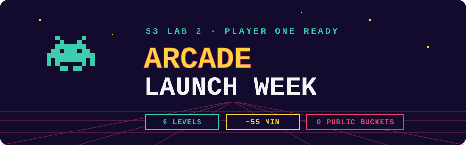
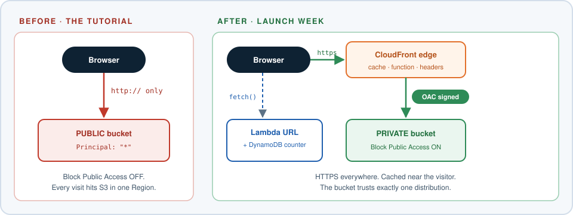
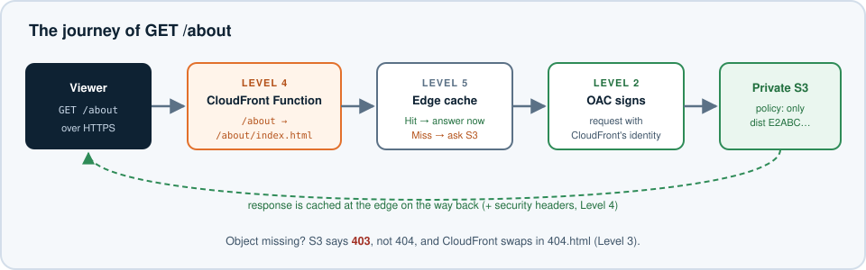
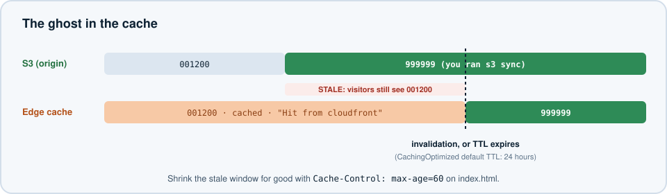
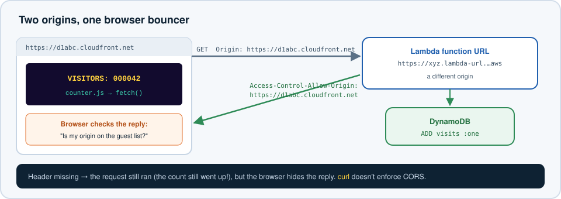

# S3 Lab 2 — Arcade Launch Week



## The Pitch

In the S3 tutorial you built a website by making a bucket **public**. It works, but it's HTTP-only, every visitor hits S3 directly, and the bucket is open to the whole internet. AWS's own tutorial warns you about it.

This week your arcade site goes to production, the way real static sites are hosted:

- The bucket stays **private**.
- **CloudFront** serves the site over HTTPS from edge locations around the world.
- A tiny **CloudFront Function** fixes your URLs.
- A **Lambda + DynamoDB** visitor counter makes the page live.



Six levels, ~55 minutes. Each level has **objectives**, a **level check**, and **hints**. Open the hints one at a time.

**You already know** S3 buckets, Lambda, and IAM basics. **You'll learn:** CloudFront distributions, Origin Access Control (OAC), CloudFront Functions, cache behaviour and invalidations, Lambda function URLs, and CORS.

---

## Shared Account Naming

Everyone is in the **same AWS account**. Prefix everything with your ID (`user07` in the examples).

| You create | Name it | Unique across… |
|---|---|---|
| S3 bucket | `user07-arcade-<6 random chars>` | **Every AWS account in the world** |
| CloudFront distribution | *(no name!)* Description: `user07-arcade` | Distributions only have IDs. The description is how you'll find yours in a list of 20. |
| Origin access control | `user07-arcade-oac` | This account |
| CloudFront Function | `user07-pretty-urls` | This account |
| DynamoDB table | `user07-arcade-visits` | This account + Region |
| Lambda function | `user07-arcade-counter` | This account + Region |

> **Golden rule:** CloudFront is a global service, so the console shows everyone's distributions. Check the **Description** column before you edit anything.

---

## Level 0 — Insert Coin (3 min)

Generate the arcade on your VM. **Set your ID on the first line.**

```bash
export ID=user07   # <-- your ID
mkdir -p ~/arcade/about && cd ~/arcade

cat > index.html <<EOF
<!doctype html><html lang="en"><head><meta charset="utf-8">
<meta name="viewport" content="width=device-width,initial-scale=1">
<title>$ID's Arcade</title>
<style>
 body{margin:0;min-height:100vh;display:grid;place-items:center;background:#120b2e;color:#f5f5f5;font-family:"Courier New",monospace;text-align:center}
 h1{font-size:clamp(32px,8vw,72px);color:#ffd23f;text-shadow:4px 4px 0 #ee4266;margin:0}
 .score{font-size:28px;color:#3bceac} a{color:#ee4266}
</style></head><body><main>
<p>PLAYER ONE</p>
<h1>$ID's ARCADE</h1>
<p class="score">HIGH SCORE: 001200</p>
<p>VISITORS: <span id="visits">INSERT COIN</span></p>
<p><a href="/about">about</a> · <a href="/secret-level">secret level</a></p>
</main><script src="/counter.js"></script></body></html>
EOF

cat > 404.html <<'EOF'
<!doctype html><html><head><meta charset="utf-8"><title>Game Over</title></head>
<body style="margin:0;min-height:100vh;display:grid;place-items:center;background:#000;color:#ee4266;font-family:'Courier New',monospace;text-align:center">
<main><h1 style="font-size:64px">GAME OVER</h1><p>404 · level not found</p><p><a style="color:#ffd23f" href="/">CONTINUE?</a></p></main>
</body></html>
EOF

cat > about/index.html <<EOF
<!doctype html><html><head><meta charset="utf-8"><title>About</title></head>
<body style="margin:0;min-height:100vh;display:grid;place-items:center;background:#120b2e;color:#3bceac;font-family:'Courier New',monospace;text-align:center">
<main><h1>ABOUT $ID's ARCADE</h1><p>Private S3 bucket · CloudFront · Lambda · DynamoDB</p><p><a style="color:#ffd23f" href="/">back</a></p></main>
</body></html>
EOF

echo '// Level 6 replaces this file' > counter.js
ls -R
```

**Level check:** you have `index.html`, `404.html`, `counter.js`, and `about/index.html`. 🪙

---

## Level 1 — The Vault (6 min)

**Objectives**

1. A bucket named `<id>-arcade-<6 random chars>` in **us-west-2**, with **Block all public access left ON**.
2. Your arcade files uploaded to it, keeping the `about/` folder.
3. **No** static website hosting. **No** bucket policy yet.

**Level check:** opening an object's **Object URL** (`https://<bucket>.s3.us-west-2.amazonaws.com/index.html`) in a browser returns `AccessDenied`. That's the **win condition** for this level. 🪙

<details>
<summary>Hint 1 — a globally unique name</summary>

```bash
export BUCKET="$ID-arcade-$(openssl rand -hex 3)"
echo $BUCKET
aws s3 mb s3://$BUCKET --region us-west-2
```

New buckets block public access by default. Leave it that way.
</details>

<details>
<summary>Hint 2 — upload everything at once</summary>

```bash
aws s3 sync ~/arcade s3://$BUCKET/
aws s3 ls s3://$BUCKET --recursive
```

`sync` only uploads files that changed, which you'll appreciate in Level 5.
</details>

> **Save your bucket name.** Run `echo "export BUCKET=$BUCKET" >> ~/.bashrc` so it survives a new terminal.

---

## Level 2 — Go Global (12 min)

Put **CloudFront** in front of the private bucket. CloudFront needs a way to read a bucket the public can't. That's **Origin Access Control (OAC)**: CloudFront signs its requests to S3, and the bucket policy trusts only *your* distribution.



**Objectives**

1. A CloudFront distribution with:
   - Origin: your bucket's **S3 REST endpoint** (`<bucket>.s3.us-west-2.amazonaws.com`), **not** a website endpoint
   - Origin access: **Origin access control**, a new OAC named `<id>-arcade-oac`
   - Viewer protocol policy: **Redirect HTTP to HTTPS**
   - Cache policy: **CachingOptimized**
   - Default root object: `index.html`
   - Web Application Firewall: **Do not enable**
   - Price class: **Use only North America and Europe**
   - Description: `<id>-arcade`
2. Your bucket policy updated with the statement CloudFront gives you.
3. Block Public Access **still on**.

**Level check** (deployment takes ~3–5 minutes; start Level 3's reading while you wait):

1. `https://<your-distribution>.cloudfront.net` shows your arcade, with a padlock. 🪙
2. The S3 Object URL from Level 1 **still** says `AccessDenied`. 🪙

<details>
<summary>Hint 1 — where's the bucket policy?</summary>

Depending on the console version, CloudFront either offers to **update the bucket policy for you** (let it, then go and read what it wrote), or shows a banner with **"Copy policy"** after you create the distribution. Copy it, then open your bucket → **Permissions** → **Bucket policy** → **Edit** → paste → **Save**. If you missed the banner, open the distribution → **Origins** → select the origin → **Edit**, and it's there again.
</details>

<details>
<summary>Hint 2 — what does the policy actually say?</summary>

```json
{
  "Effect": "Allow",
  "Principal": { "Service": "cloudfront.amazonaws.com" },
  "Action": "s3:GetObject",
  "Resource": "arn:aws:s3:::YOUR-BUCKET/*",
  "Condition": {
    "StringEquals": { "AWS:SourceArn": "arn:aws:cloudfront::ACCOUNT:distribution/YOUR-DIST-ID" }
  }
}
```

Read it out loud: "The CloudFront service may read objects, **but only when the request comes from this one distribution**." Without the `Condition`, *anyone's* distribution in *any* account could read your bucket. Why doesn't this count as "public" to Block Public Access?
</details>

<details>
<summary>Hint 3 — 403 or a blank page from CloudFront</summary>

- Still **Deploying**? Wait for "Last modified" to show a date.
- Origin domain must be `…s3.us-west-2.amazonaws.com`. If you picked the `s3-website` endpoint, OAC can't sign requests to it.
- Check the bucket policy's `Resource` and `SourceArn` match **your** bucket and distribution.
- No **default root object**? Then `/` asks S3 for an object with an empty key, which doesn't exist.
</details>

---

## Level 3 — Game Over Screen (6 min)

Visit `https://<your-distribution>.cloudfront.net/secret-level`.

You expected a "404 Not Found." You got an ugly XML **403 AccessDenied**. That's not a bug.

**Objectives**

1. Explain why a missing object returns **403**, not 404.
2. Make missing pages show your `404.html` **with a real 404 status code**.

**Level check:** `curl -s -o /dev/null -w "%{http_code}\n" https://<dist>.cloudfront.net/secret-level` prints `404`, and the browser shows **GAME OVER**. 🪙

<details>
<summary>Hint 1 — why 403?</summary>

Your bucket policy grants CloudFront `s3:GetObject`, but **not** `s3:ListBucket`. Without list permission, S3 won't say whether an object *exists*. Otherwise anyone could probe for file names. So "doesn't exist" and "not allowed" look the same: 403.
</details>

<details>
<summary>Hint 2 — where to fix it</summary>

Distribution → **Error pages** → **Create custom error response**:

- HTTP error code: **403**
- Customize error response: **Yes**
- Response page path: `/404.html`
- HTTP response code: **404**

Wait for it to deploy, then test again.
</details>

Now try `https://<dist>.cloudfront.net/about`. Game Over? Hold that thought for Level 4.

---

## Level 4 — Warp Pipes (8 min)

`/about` should show `about/index.html`. On an S3 *website* endpoint, that works automatically. Through CloudFront's REST origin, the **default root object only applies to `/`**, so `/about` asks S3 for a key literally named `about`, which doesn't exist.

You'll fix it with a **CloudFront Function**: a few lines of JavaScript that run at the edge on every request, in under a millisecond, before the cache lookup.

| | CloudFront Functions | Lambda@Edge |
|---|---|---|
| Runs | At 400+ edge locations | At regional edge caches |
| Language | JavaScript (restricted) | Node.js, Python |
| Max time | ~1 ms | 5–30 s |
| Can call the network? | No | Yes |
| Good for | URL rewrites, headers, redirects | Auth, calling APIs, image resizing |

**Objectives**

1. A CloudFront Function `<id>-pretty-urls` that rewrites:
   - `/about` → `/about/index.html`
   - `/about/` → `/about/index.html`
   - and leaves `/counter.js`, `/404.html`, `/` alone
2. Published, and associated with your distribution's default behaviour as a **Viewer request** function.
3. **Bonus armour:** attach the managed response headers policy **SecurityHeadersPolicy** to the default behaviour.

**Level check**

1. `/about` and `/about/` both show the About page. 🪙
2. `curl -sI https://<dist>.cloudfront.net/ | grep -i strict-transport` prints a header. 🪙

<details>
<summary>Hint 1 — the event shape</summary>

```javascript
function handler(event) {
    var request = event.request;   // request.uri is the path, e.g. "/about"
    // ...change request.uri...
    return request;                // returning the request lets it continue to the cache/origin
}
```

How can you tell `/about` (a folder) from `/counter.js` (a file)? Look for a `.` in the URI.
</details>

<details>
<summary>Hint 2 — the logic</summary>

```javascript
function handler(event) {
    var request = event.request;
    var uri = request.uri;

    if (uri.endsWith('/')) {
        request.uri = uri + 'index.html';
    } else if (______) {
        request.uri = uri + '/index.html';
    }
    return request;
}
```

Use the console's **Test** tab with a URI of `/about` before you publish.
</details>

<details>
<summary>Hint 3 — publish vs associate</summary>

Saving only updates the *development* stage. Click **Publish**, then **Add association** → your distribution → Event type **Viewer request** → Cache behaviour **Default (*)**. The distribution redeploys for a few minutes.

For headers: Distribution → **Behaviors** → edit **Default (*)** → **Response headers policy** → **SecurityHeadersPolicy**.
</details>

---

## Level 5 — The Ghost in the Cache (6 min)

**Objectives**

1. Beat the high score: change `HIGH SCORE: 001200` to `HIGH SCORE: 999999` in `~/arcade/index.html`, then `aws s3 sync ~/arcade s3://$BUCKET/`.
2. Reload your CloudFront URL. **It still says 001200.** Explain why.
3. Make the new score appear **without** waiting a day.
4. Make sure future `index.html` changes show up within **60 seconds** automatically.



**Level check:** the site shows `999999`, and `aws s3api head-object --bucket $BUCKET --key index.html` shows a `CacheControl` value. 🪙

<details>
<summary>Hint 1 — why is it stale?</summary>

**CachingOptimized** keeps objects at the edge for **24 hours** by default, unless the origin says otherwise. CloudFront doesn't know you changed S3. Run `curl -sI https://<dist>.cloudfront.net/ | grep -i x-cache`. `Hit from cloudfront` means S3 wasn't even asked.
</details>

<details>
<summary>Hint 2 — the fast fix: invalidation</summary>

```bash
export DIST=<your-distribution-id>
aws cloudfront create-invalidation --distribution-id $DIST --paths "/index.html" "/"
```

An invalidation tells every edge location to drop that cached copy. The first 1,000 paths per month are free. It's the emergency brake, not the everyday tool.
</details>

<details>
<summary>Hint 3 — the lasting fix: tell the cache how long</summary>

Re-upload `index.html` with a `Cache-Control` header. CloudFront honours it (within the cache policy's min/max TTL):

```bash
aws s3 cp ~/arcade/index.html s3://$BUCKET/index.html --cache-control "max-age=60"
```

Real sites cache HTML briefly and give CSS/JS **versioned file names** (`app.3f9c2.js`) with very long cache times. A new version is a new URL, so no invalidation is needed.
</details>

---

## Level 6 — High Score Table (14 min)

The page says `VISITORS: INSERT COIN`. Make it count real visits.



**Objectives**

1. DynamoDB table `<id>-arcade-visits`, partition key `page` (String), **on-demand** capacity.
2. Lambda function `<id>-arcade-counter` (Python 3.13), using the execution role your instructor provided (for example `arcade-counter-role`), with environment variable `TABLE_NAME` set to your table name. Code:

   ```python
   import json, os, boto3

   table = boto3.resource("dynamodb").Table(os.environ["TABLE_NAME"])

   def lambda_handler(event, context):
       result = table.update_item(
           Key={"page": "home"},
           UpdateExpression="ADD visits :one",
           ExpressionAttributeValues={":one": 1},
           ReturnValues="UPDATED_NEW",
       )
       return {
           "statusCode": 200,
           "headers": {"Content-Type": "application/json"},
           "body": json.dumps({"visits": int(result["Attributes"]["visits"])}),
       }
   ```

3. A **function URL** with auth type **NONE**. **Don't configure CORS yet.**
4. Replace `~/arcade/counter.js` with this, using your function URL:

   ```javascript
   const COUNTER_URL = "https://REPLACE-ME.lambda-url.us-west-2.on.aws/";
   const el = document.getElementById("visits");

   fetch(COUNTER_URL)
     .then((r) => r.json())
     .then((d) => { el.textContent = String(d.visits).padStart(6, "0"); })
     .catch((err) => { el.textContent = "TILT!"; console.error(err); });
   ```

5. Upload `counter.js` and get CloudFront to serve the new version (you know how from Level 5).
6. Load the site. You'll see **TILT!**. Open the browser's developer console, read the error, and fix it **without changing any code**.

**Level check:** the visitor counter goes up every time you refresh. 🪙🪙 (double coin: final boss)

<details>
<summary>Hint 1 — test the backend alone first</summary>

```bash
curl -s https://<your-function-url>/
```

Run it a few times. If the number goes up, Lambda and DynamoDB are fine, and the problem is in the browser.
</details>

<details>
<summary>Hint 2 — "blocked by CORS policy"</summary>

Your page lives on `https://dxxxx.cloudfront.net`. The counter lives on `https://xxxx.lambda-url…`. Different **origins**. Browsers refuse to let a page read a response from another origin unless that origin's response includes `Access-Control-Allow-Origin` naming the page's origin. `curl` doesn't care, which is why Hint 1 worked.
</details>

<details>
<summary>Hint 3 — fix it in configuration</summary>

Lambda → your function → **Configuration** → **Function URL** → **Edit** → tick **Configure cross-origin resource sharing (CORS)**:

- Allow origin: `https://<your-dist>.cloudfront.net` (exactly, no trailing slash)
- Allow methods: `GET`

Don't *also* add CORS headers in your Python code. Two `Access-Control-Allow-Origin` headers is its own error.
</details>

<details>
<summary>Hint 4 — still TILT! after fixing CORS</summary>

- Is CloudFront still serving the **old** `counter.js`? Check with `curl https://<dist>.cloudfront.net/counter.js`. Invalidate `/counter.js` if so.
- `AccessDeniedException` in the Lambda logs (CloudWatch → Log groups → `/aws/lambda/<id>-arcade-counter`)? Check the `TABLE_NAME` value matches your table exactly.
- The counter should be a **Number** attribute. `ADD` creates it the first time.
</details>

> **Think about it:** your function URL is public with no auth. What stops someone from running `curl` in a loop and inflating your visitor count? Name two ways you could protect it.

---

## Bonus Levels

- **👾 Time machine.** Turn on **Versioning** for your bucket. Upload a "hacked" `index.html` (`HIGH SCORE: 000000`), then restore the previous version **from the S3 console or CLI**. Invalidate, and confirm the real score is back.
- **👾 Where in the world?** Run `curl -sI https://<dist>.cloudfront.net/ | grep -i -E "x-cache|x-amz-cf-pop"` twice. What does the POP code tell you about where you're being served from? Ask a classmate in another city to compare.
- **👾 Bot shield.** Change the Lambda so it only counts a visit when the request's `Origin` header is your CloudFront domain. (Look in `event["headers"]`.) Does that stop `curl`? Why not, completely?

---

## Clean Up — Game Over (6 min)

CloudFront is slow to delete, so start with it.

1. **Distribution:** **Disable** it. While it disables (~5 min), keep going.
2. Lambda function `<id>-arcade-counter` (its function URL goes with it). Then delete its log group `/aws/lambda/<id>-arcade-counter`.
3. DynamoDB table `<id>-arcade-visits`.
4. When the distribution shows **Disabled**: **Delete** it.
5. CloudFront Function `<id>-pretty-urls` (only possible once nothing is associated with it), then OAC `<id>-arcade-oac`.
6. Bucket: empty it (including old **versions**, if you did the bonus), then delete it:

   ```bash
   aws s3 rm s3://$BUCKET --recursive
   aws s3 rb s3://$BUCKET
   ```

   If you turned on versioning, use the console's **Empty** button instead. It also removes old versions.

---

## Level Up — What You Learned

| Concept | One-line takeaway |
|---|---|
| OAC + private bucket | CloudFront can read it; the internet can't |
| `AWS:SourceArn` condition | Trust *one* distribution, not "CloudFront" in general |
| REST origin vs website endpoint | OAC needs the REST endpoint; default root object only covers `/` |
| 403 for missing objects | No `ListBucket` = S3 won't confirm what exists |
| CloudFront Functions | Sub-millisecond JavaScript at the edge for rewrites and headers |
| Cache-Control & invalidations | TTLs control freshness; invalidation is the emergency brake |
| Function URLs | An HTTPS endpoint for a Lambda, no API Gateway required |
| CORS | A browser rule: the *server* must allow the page's origin |
