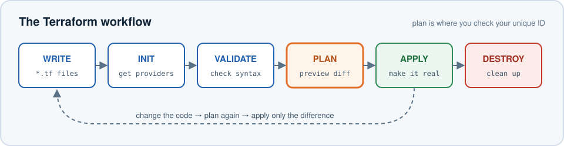
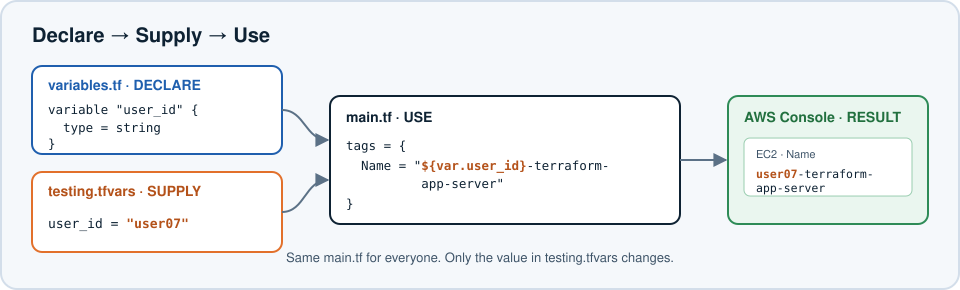
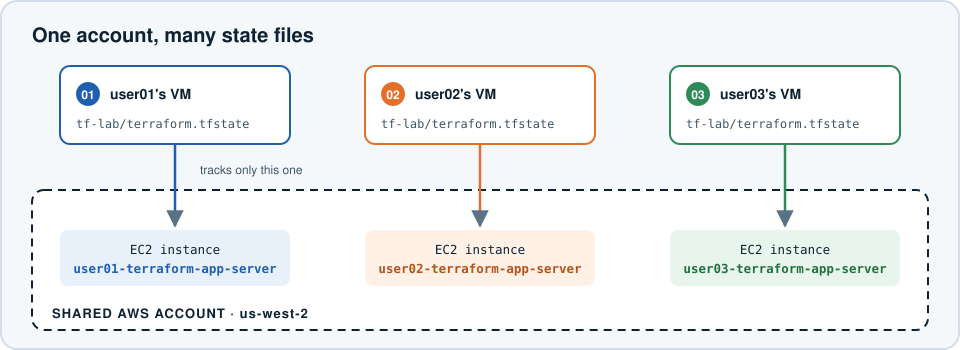

# Terraform Lab 1 — Deploying AWS Infrastructure as Code

## Lab Overview

In this lab you will use **Terraform** to create AWS resources using Infrastructure as Code (IaC).

Instead of clicking through the AWS Console to create an EC2 instance, you will *describe* the infrastructure you want in Terraform configuration files. Terraform then talks to AWS and makes reality match your description.

> **Shared account:** This AWS account is shared by everyone in the class. You will put your **unique ID** in the name of everything you create so you can tell your resources apart from everyone else's. **Never modify or delete resources that belong to someone else.**



**What you will practice**

| Part | Topic | Approx. time |
|---|---|---|
| 1 | Create, inspect, and destroy an EC2 instance | 30 min |
| 2 | Input variables | 10 min |
| 3 | Outputs | 10 min |
| 4 | Changing existing infrastructure | 10 min |
| Bonus | Build your own VPC and subnets | 20 min |

---

# Part 1 — Create an EC2 Instance with Terraform

## Step 1 — Configure AWS Credentials

Terraform needs permission to talk to AWS. From your VM, configure the AWS CLI:

```bash
aws configure
```

Enter the credentials provided to you:

```text
AWS Access Key ID:     <provided access key>
AWS Secret Access Key: <provided secret key>
Default region name:   us-west-2
Default output format: json
```

Verify that the credentials work:

```bash
aws sts get-caller-identity
```

You should see JSON containing an `Account`, a `UserId`, and an `Arn`. Terraform will automatically use these same credentials.

> **Never put AWS access keys or secret keys inside Terraform files.** Terraform files are meant to be shared and committed to source control; credentials are not.

---

## Step 2 — Note Your Unique ID

Your instructor has assigned you an ID such as:

```text
user01
user02
user03
...
```

You will use this ID throughout the lab. If your ID is `user07`, your EC2 instance will be named:

```text
user07-terraform-app-server
```

Write your ID down now: `user____`

---

## Step 3 — Create Your Terraform Working Directory

```bash
mkdir tf-lab
cd tf-lab
pwd
```

Terraform treats **all `.tf` files in the current directory** as one configuration.

> **Important:** Always run Terraform from your own `tf-lab` directory. Your Terraform *state* will be stored here, and it is how Terraform knows which AWS resources are yours.

---

## Step 4 — Create `main.tf`

Create a file named `main.tf` (VS Code or any text editor works) and add:

```hcl
terraform {
  required_providers {
    aws = {
      source  = "hashicorp/aws"
      version = "~> 6.0"
    }
  }
}

provider "aws" {
  region = "us-west-2"
}

# Find the latest Amazon Linux 2023 AMI
data "aws_ami" "amazon_linux" {
  most_recent = true
  owners      = ["amazon"]

  filter {
    name   = "name"
    values = ["al2023-ami-2023.*-x86_64"]
  }

  filter {
    name   = "virtualization-type"
    values = ["hvm"]
  }
}

# Find the default VPC
data "aws_vpc" "default" {
  default = true
}

# Find the subnets in the default VPC
data "aws_subnets" "default" {
  filter {
    name   = "vpc-id"
    values = [data.aws_vpc.default.id]
  }
}

# Create an EC2 instance
resource "aws_instance" "app_server" {
  ami           = data.aws_ami.amazon_linux.id
  instance_type = "t3.micro"
  subnet_id     = data.aws_subnets.default.ids[0]

  tags = {
    Name = "${var.user_id}-terraform-app-server"
  }
}
```

Save the file. (It references `var.user_id`, which you will declare in Step 8.)

---

## Step 5 — Understand `main.tf`: the Provider

Terraform uses **providers** to talk to external platforms. This block says "this configuration needs the AWS provider":

```hcl
terraform {
  required_providers {
    aws = {
      source  = "hashicorp/aws"
      version = "~> 6.0"
    }
  }
}
```

- `source` says where to download the provider from (the public Terraform Registry).
- `version = "~> 6.0"` means "any 6.x version." Pinning a version keeps everyone in the class on compatible behavior.

Think of a provider as a plugin that translates Terraform into API calls:

```text
Terraform  ──►  AWS provider  ──►  AWS APIs
```

There are providers for AWS, Azure, Google Cloud, Kubernetes, GitHub, and thousands of other systems.

The next block configures the provider:

```hcl
provider "aws" {
  region = "us-west-2"
}
```

This says: *create and manage our AWS resources in `us-west-2`.* Notice there are no credentials here — the provider picks up the ones you set with `aws configure`.

---

## Step 6 — Understand Data Sources

Several blocks begin with `data`. A **data source** looks up something that **already exists**.

| Block | Meaning |
|---|---|
| `resource` | **Create and manage** something |
| `data` | **Look up** something that already exists (read-only) |

### Find an Amazon Linux AMI

Every EC2 instance needs an Amazon Machine Image (AMI). Instead of copying an AMI ID that will go out of date, Terraform looks up the newest Amazon Linux 2023 image published by Amazon:

```hcl
data "aws_ami" "amazon_linux" {
  most_recent = true
  owners      = ["amazon"]
  ...
}
```

You reference the result elsewhere as `data.aws_ami.amazon_linux.id`.

### Find the Default VPC

```hcl
data "aws_vpc" "default" {
  default = true
}
```

Terraform is **not** creating this VPC. It is only looking up the account's existing default VPC.

### Find a Subnet

```hcl
data "aws_subnets" "default" {
  filter {
    name   = "vpc-id"
    values = [data.aws_vpc.default.id]
  }
}
```

Notice `data.aws_vpc.default.id`: Terraform takes the ID of the VPC it found and uses it to look up that VPC's subnets.

> **Key idea:** One part of a configuration can use information discovered or created by another part. Terraform works out the correct order automatically.

---

## Step 7 — Understand the EC2 Resource

```hcl
resource "aws_instance" "app_server" {
  ami           = data.aws_ami.amazon_linux.id
  instance_type = "t3.micro"
  subnet_id     = data.aws_subnets.default.ids[0]

  tags = {
    Name = "${var.user_id}-terraform-app-server"
  }
}
```

A **resource** is infrastructure that Terraform creates and manages. The syntax is:

```hcl
resource "<RESOURCE_TYPE>" "<LOCAL_NAME>" {
  # arguments
}
```

| Part | Value | Meaning |
|---|---|---|
| Resource type | `aws_instance` | An EC2 instance (the `aws_` prefix means it comes from the AWS provider) |
| Local name | `app_server` | Terraform's **internal** name — you won't see it in the AWS Console |
| `Name` tag | `user07-terraform-app-server` | The name you **will** see in the AWS Console |

---

## Step 8 — Create `variables.tf`

`main.tf` uses `var.user_id`, so we must declare that variable. Create `variables.tf`:

```hcl
variable "user_id" {
  description = "Unique ID used to identify resources created by this user"
  type        = string
}
```

Terraform now knows the configuration expects a string called `user_id`.

---

## Step 9 — Create `testing.tfvars`

Create `testing.tfvars` and add **your** ID:

```hcl
user_id = "user07"
```

> **Replace `user07` with your actual assigned ID.**

Three files, three jobs:



| File | Job | Example |
|---|---|---|
| `variables.tf` | **Declares** which inputs exist | `variable "user_id" { type = string }` |
| `testing.tfvars` | **Supplies** values for those inputs | `user_id = "user07"` |
| `main.tf` | **Uses** the values | `Name = "${var.user_id}-terraform-app-server"` |

Result: `user07-terraform-app-server`

---

## Step 10 — Initialize Terraform

```bash
terraform init
```

`terraform init` prepares the directory. Terraform reads `required_providers`, downloads the AWS provider into a hidden `.terraform/` folder, and records the exact version in `.terraform.lock.hcl`.

You should see:

```text
Terraform has been successfully initialized!
```

Run `init` once when you start working in a new directory, and again whenever you add a new provider.

---

## Step 11 — Validate the Configuration

```bash
terraform validate
```

This checks that the configuration is syntactically valid and internally consistent (for example, that every `var.` you use has been declared).

```text
Success! The configuration is valid.
```

`validate` does **not** contact AWS or create anything.

> **Tip:** Run `terraform fmt` to automatically fix indentation and alignment in your `.tf` files.

---

## Step 12 — Preview the Changes

```bash
terraform plan -var-file="testing.tfvars"
```

Terraform compares your configuration with what already exists and shows what it *would* do. Look for:

```text
Plan: 1 to add, 0 to change, 0 to destroy.
```

Now find the `Name` tag in the plan output. It must contain **your** ID:

```text
+ tags = {
    + "Name" = "user07-terraform-app-server"
  }
```

> **STOP:** If the name does not contain your assigned ID, fix `testing.tfvars` before continuing.

`plan` creates nothing. It is a preview.

---

## Step 13 — Create the EC2 Instance

```bash
terraform apply -var-file="testing.tfvars"
```

Terraform shows the plan again and asks:

```text
Do you want to perform these actions?
  Enter a value:
```

Check one more time that your ID appears in the name, then type:

```text
yes
```

Terraform calls the AWS APIs and creates your instance. When it finishes:

```text
Apply complete! Resources: 1 added, 0 changed, 0 destroyed.
```

---

## Step 14 — Verify Your EC2 Instance

In the AWS Console, go to **EC2 → Instances** (make sure the region selector says **Oregon / us-west-2**).

Find the instance with **your** ID, for example `user07-terraform-app-server`. You will also see other participants' instances.

> **Do not stop, terminate, reboot, rename, or otherwise modify another person's EC2 instance.**

You just created infrastructure with code:

```text
main.tf ──► Terraform ──► AWS provider ──► AWS API ──► your EC2 instance
```

---

## Step 15 — Examine Terraform State

```bash
ls -la
```

You should now see `terraform.tfstate`. Terraform uses **state** to remember which real resources it manages.

```bash
terraform state list
```

You should see something like:

```text
data.aws_ami.amazon_linux
data.aws_subnets.default
data.aws_vpc.default
aws_instance.app_server
```

`aws_instance.app_server` matches `resource "aws_instance" "app_server"` in `main.tf`. The `data.` entries are the lookups Terraform performed.

To see everything Terraform knows about your instance:

```bash
terraform state show aws_instance.app_server
```

Your state file tracks **your** instance. Every other participant has their own state file, in their own directory, tracking theirs:



That is why you must always run Terraform from your own directory, and never copy someone else's `terraform.tfstate`.

---

## Step 16 — Destroy Your EC2 Instance

From **your own `tf-lab` directory**:

```bash
terraform destroy -var-file="testing.tfvars"
```

Review the plan carefully. You should see your resource name and:

```text
Plan: 0 to add, 0 to change, 1 to destroy.
```

Only after confirming it will destroy **your** resource, type `yes`. Eventually:

```text
Destroy complete! Resources: 1 destroyed.
```

Verify in the Console that your instance is **Shutting down** or **Terminated**.

> **Never manually terminate another participant's EC2 instance.**

---

# Part 2 — Working with Variables

You already used one variable, `var.user_id`. Why bother with it?

Suppose we had hardcoded the name:

```hcl
tags = {
  Name = "user07-terraform-app-server"
}
```

It works — but every other participant would have to edit `main.tf` to change it to `user08-...`, `user09-...`, and so on. The configuration would not be reusable.

With a variable:

```hcl
Name = "${var.user_id}-terraform-app-server"
```

**everyone uses the exact same `main.tf`**. Only the input value changes.

## Change Your Variable Value

Open `testing.tfvars` and add `-test` to your ID:

```hcl
user_id = "user07-test"
```

Preview:

```bash
terraform plan -var-file="testing.tfvars"
```

You destroyed your instance in Step 16, so Terraform plans to **create** a new one named:

```text
user07-test-terraform-app-server
```

Apply it and type `yes`:

```bash
terraform apply -var-file="testing.tfvars"
```

Verify the new instance in the AWS Console. **Leave it running** — you will use it in Parts 3 and 4.

---

# Part 3 — Outputs

Variables let information flow **into** Terraform. **Outputs** let useful information flow **out**.

```text
variables.tf + testing.tfvars  ──►  main.tf  ──►  outputs.tf
          (inputs)                                 (outputs)
```

Create `outputs.tf`:

```hcl
output "instance_id" {
  description = "ID of the EC2 instance"
  value       = aws_instance.app_server.id
}

output "private_ip" {
  description = "Private IP address of the EC2 instance"
  value       = aws_instance.app_server.private_ip
}
```

Run apply again:

```bash
terraform apply -var-file="testing.tfvars"
```

Your instance already exists, so no infrastructure changes are needed. Terraform shows **Changes to Outputs** instead; type `yes` to record them. You can read them any time with:

```bash
terraform output
```

```text
instance_id = "i-0abc123..."
private_ip  = "172.31.x.x"
```

Look at the expression `aws_instance.app_server.id`. It follows the pattern:

```text
RESOURCE TYPE . LOCAL NAME . ATTRIBUTE
aws_instance  . app_server . id
```

Terraform can read any attribute of a resource it manages and use it elsewhere — in outputs, or as an input to another resource.

> **Tip:** `terraform output -raw instance_id` prints just the value, which is handy in scripts.

---

# Part 4 — Make a Change

Infrastructure as Code is not only about creating things. Terraform can also work out how to **change** what already exists.

Open `testing.tfvars` and change:

```hcl
user_id = "user07-test"
```

to another variation that still includes your ID:

```hcl
user_id = "user07-updated"
```

Preview:

```bash
terraform plan -var-file="testing.tfvars"
```

Look closely. This time you should see a `~` symbol and:

```text
  ~ resource "aws_instance" "app_server" {
      ~ tags = {
          ~ "Name" = "user07-test-terraform-app-server" -> "user07-updated-terraform-app-server"
        }
    }

Plan: 0 to add, 1 to change, 0 to destroy.
```

Terraform compares **what your configuration says should exist** with **what its state says does exist**, and calculates the smallest change. A tag can be changed in place, so the instance is **updated**, not replaced.

| Symbol | Meaning |
|---|---|
| `+` | create |
| `~` | update in place |
| `-` | destroy |
| `-/+` | destroy and re-create (replace) |

Apply it:

```bash
terraform apply -var-file="testing.tfvars"
```

Verify the new `Name` tag in the AWS Console. The **Instance ID is unchanged** — it is the same server with a new label.

---

# Final Cleanup

Before moving on, destroy your infrastructure. From your own `tf-lab` directory:

```bash
terraform destroy -var-file="testing.tfvars"
```

Before typing `yes`, confirm:

1. You are in your own `tf-lab` directory.
2. Terraform intends to destroy only resources in **your** state.
3. The instance name contains **your** ID.

Type `yes`, then verify in the Console that your instance is terminated.

---

# Bonus — Build a VPC with Variables

Now you will create your **own** VPC with a public and a private subnet.

> **Shared account:** every `Name` tag must include your unique ID.

> **Heads-up:** AWS limits how many VPCs an account can have per region (the default is 5). If `apply` fails with `VpcLimitExceeded`, tell your instructor rather than deleting anything.

## Create a New Directory

Keep this exercise separate from your EC2 configuration so the two states don't mix:

```bash
cd ~
mkdir tf-vpc
cd tf-vpc
```

## Create `main.tf`

```hcl
terraform {
  required_providers {
    aws = {
      source  = "hashicorp/aws"
      version = "~> 6.0"
    }
  }
}

provider "aws" {
  region = "us-west-2"
}

resource "aws_vpc" "main" {
  cidr_block = var.vpc_cidr

  tags = {
    Name = "${var.user_id}-terraform-vpc"
  }
}

resource "aws_subnet" "public_subnet" {
  vpc_id     = aws_vpc.main.id
  cidr_block = var.public_subnet_cidr

  tags = {
    Name = "${var.user_id}-terraform-public-subnet"
  }
}

resource "aws_subnet" "private_subnet" {
  vpc_id     = aws_vpc.main.id
  cidr_block = var.private_subnet_cidr

  tags = {
    Name = "${var.user_id}-terraform-private-subnet"
  }
}
```

Notice `vpc_id = aws_vpc.main.id`. Terraform creates the VPC first, then passes its ID to each subnet:

```text
aws_vpc.main
     │  VPC ID
     ├──────────► aws_subnet.public_subnet
     └──────────► aws_subnet.private_subnet
```

Terraform reads this reference and knows the VPC must exist before either subnet can be created. You never have to specify the order yourself.

## Create `variables.tf`

```hcl
variable "user_id" {
  description = "Unique ID used to identify resources"
  type        = string
}

variable "vpc_cidr" {
  description = "CIDR block for the VPC"
  type        = string
}

variable "public_subnet_cidr" {
  description = "CIDR block for the public subnet"
  type        = string
}

variable "private_subnet_cidr" {
  description = "CIDR block for the private subnet"
  type        = string
}
```

## Create `testing.tfvars`

```hcl
user_id = "user07"

vpc_cidr            = "10.0.0.0/16"
public_subnet_cidr  = "10.0.1.0/24"
private_subnet_cidr = "10.0.2.0/24"
```

Replace `user07` with your ID.

For this isolated exercise, everyone's VPC can use the same private CIDR ranges. Do not peer or otherwise connect lab VPCs to each other.

## Run It

```bash
terraform init
terraform validate
terraform plan -var-file="testing.tfvars"
```

Expect `Plan: 3 to add, 0 to change, 0 to destroy.` Check that **every** `Name` tag contains your ID, then:

```bash
terraform apply -var-file="testing.tfvars"
```

Verify in the Console under **VPC → Your VPCs** and **VPC → Subnets**. Find yours by your ID, and do not modify anyone else's.

> **Stretch:** Add an `outputs.tf` that prints the VPC ID and both subnet IDs.

## Clean Up the VPC Exercise

From your `tf-vpc` directory:

```bash
terraform destroy -var-file="testing.tfvars"
```

Check that every resource being destroyed contains your ID, type `yes`, and confirm in the Console that your VPC is gone.

---

# Shared AWS Account Rules

1. **Always use your assigned unique ID in resource names.**
2. **Only run Terraform from your own directories.**
3. **Never share or copy another person's `terraform.tfstate` file.**
4. **Always review `terraform plan` before running `terraform apply`.**
5. **Always review the destroy plan before approving `terraform destroy`.**
6. **Never manually modify or delete another person's AWS resources.**
7. **Do not modify the shared default VPC or its subnets.**
8. **Never put AWS credentials in `.tf` or `.tfvars` files.**
9. **Destroy your lab resources when you finish.**
10. Use the `Name` tag to find the resources that contain your ID.

---

# Key Takeaways

| Concept | Purpose |
|---|---|
| Infrastructure as Code | Define infrastructure in files instead of creating it by hand |
| Provider | Plugin that lets Terraform talk to a platform such as AWS |
| Resource | Infrastructure Terraform creates and manages |
| Data source | Read-only lookup of something that already exists |
| `main.tf` | Usually holds the main infrastructure definitions |
| `variables.tf` | Declares input variables |
| `.tfvars` | Supplies values for variables |
| Output | Exposes useful values from Terraform |
| State | Terraform's record of the infrastructure it manages |
| `terraform init` | Prepares the directory and installs providers |
| `terraform validate` | Checks the configuration for errors |
| `terraform plan` | Previews proposed changes |
| `terraform apply` | Makes the proposed changes |
| `terraform destroy` | Removes the infrastructure in your state |

```text
WRITE      .tf files
INIT       terraform init
VALIDATE   terraform validate
PLAN       terraform plan    -var-file="testing.tfvars"
REVIEW     check your unique resource names
APPLY      terraform apply   -var-file="testing.tfvars"
VERIFY     check resources in AWS
STATE      Terraform tracks what it created
DESTROY    terraform destroy -var-file="testing.tfvars"
```

**You describe the infrastructure you want. Terraform compares that description with what it already manages and works out what to create, change, or destroy.**
