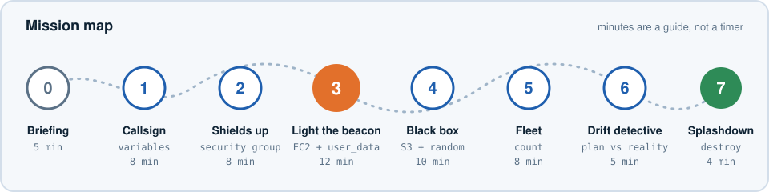
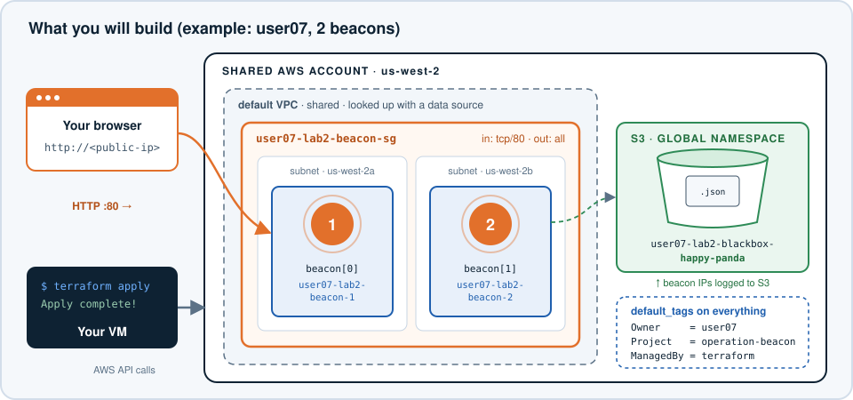
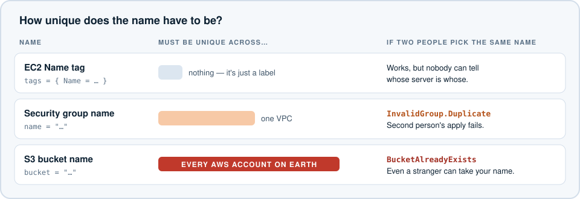
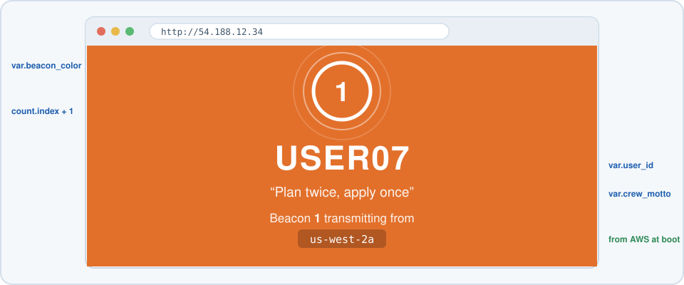
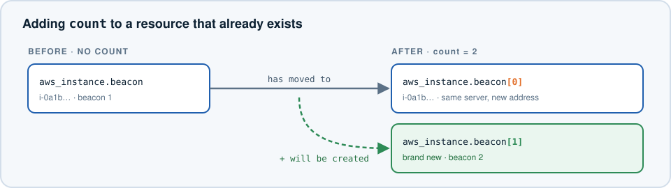
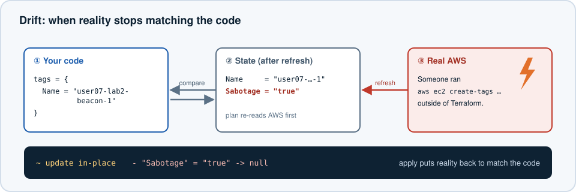

# Terraform Lab 2 — Operation Beacon


## Mission Briefing

In Lab 1 you followed step-by-step instructions. This time, you get **objectives** instead of instructions.

Your mission: launch a **web beacon** that broadcasts your callsign to the internet, record its location in a **black-box bucket**, then scale it into a **fleet** — all in an AWS account shared with the rest of the class, without a single naming collision.

Each mission gives you:

- **Objectives** — what must be true when you are done.
- **Mission check** — how to prove it worked.
- **Hints** — click to expand. They start as gentle nudges and get more specific. Try the first hint before opening the next one.



Here is everything you will have built by Mission 5:



> **Shared account rules still apply.** Everything you create must contain your ID. Never touch resources that belong to anyone else. Always read the plan before typing `yes`.

**Scoring (just for fun):** earn ⭐ for each mission check you pass, and 🌟 for each extra-credit or side quest. Compare at the end.

---

## Mission 0 — Prepare the Launch Pad (5 min)

**Objectives**

1. A new working directory called `tf-beacon`, separate from your Lab 1 directories.
2. A `main.tf` that contains the `terraform` block, the `provider "aws"` block, and the three data sources from Lab 1 (`aws_ami`, `aws_vpc`, `aws_subnets`) — but **no** `aws_instance` resource.
3. `terraform init` succeeds.

<details>
<summary>Hint 1</summary>

Start from your Lab 1 `main.tf`. Copy it into the new directory and delete the `resource "aws_instance" "app_server"` block.

```bash
mkdir ~/tf-beacon
cp ~/tf-lab/main.tf ~/tf-beacon/
cd ~/tf-beacon
```

Do **not** copy `terraform.tfstate`. A new directory should start with an empty state.
</details>

**Mission check:** `terraform init` prints `Terraform has been successfully initialized!` ⭐

---

## Mission 1 — Lock In Your Callsign (8 min)

Your callsign is your user ID. In a shared account, a typo in the ID (`User7`, `user7`, `usr07`) means resources that nobody can find or clean up. You will make Terraform **refuse** a bad ID.

**Objectives**

1. In `variables.tf`, declare three variables:

   | Variable | Type | Default | Rule |
   |---|---|---|---|
   | `user_id` | string | none | Must look exactly like `user07` (lowercase `user` + two digits) |
   | `crew_motto` | string | anything fun | 1–60 characters |
   | `beacon_color` | string | a hex color like `"#1f5fae"` | Must be `#` followed by 6 hex digits |

2. In `main.tf`, add a `locals` block with:
   - `name_prefix` = your user ID followed by `-lab2` (for example `user07-lab2`)
   - `common_tags` = a map with `Owner` (your ID), `Project = "operation-beacon"`, and `ManagedBy = "terraform"`
3. Configure the AWS provider so that **every** resource automatically receives `common_tags`.
4. Create `testing.tfvars` with your `user_id`, a `crew_motto`, and a `beacon_color` of your choice.

**Mission check**

1. Set `user_id = "User7"` in `testing.tfvars` and run `terraform plan -var-file="testing.tfvars"`. You should see **your own error message**. ⭐
2. Set it back to your real ID. `terraform plan` should now succeed with `No changes` (there are no resources yet).

<details>
<summary>Hint 1 — validation blocks</summary>

A variable can contain a `validation` block with a `condition` (must be true) and an `error_message`:

```hcl
variable "example" {
  type = string

  validation {
    condition     = ______
    error_message = "Explain what a valid value looks like."
  }
}
```
</details>

<details>
<summary>Hint 2 — regular expressions</summary>

`regex(pattern, string)` returns the match, or **fails** if there is no match. `can(...)` turns "fails" into `false` and "works" into `true`. Together:

```hcl
condition = can(regex("^user[0-9]{2}$", var.user_id))
```

- `^` and `$` mean "start" and "end" — the whole string must match.
- What pattern would match `#` followed by exactly 6 characters from `0-9`, `a-f`, `A-F`?
- For the motto, look at the `length()` function.
</details>

<details>
<summary>Hint 3 — locals and default tags</summary>

```hcl
locals {
  name_prefix = "${var.user_id}-lab2"

  common_tags = {
    Owner     = ______
    Project   = "operation-beacon"
    ManagedBy = "terraform"
  }
}
```

The AWS provider block accepts a nested `default_tags` block, which contains a `tags` argument:

```hcl
provider "aws" {
  region = "us-west-2"

  default_tags {
    tags = ______
  }
}
```
</details>

> **Captain's log:** Why is `default_tags` especially useful in a *shared* account? (Think about Mission 7.)

---

## Mission 2 — Shields Up (8 min)

Your beacon needs a **security group** that lets web traffic (HTTP, port 80) in, and lets the server reach the internet so it can install software.

Before you write it, look at how strict AWS is about different kinds of names:



Everyone in the class is putting their security group in the **same default VPC**. If two people use the same security group name, the second `apply` fails.

**Objectives**

1. A security group in the **default VPC** named `<name_prefix>-beacon-sg` (for example `user07-lab2-beacon-sg`), with a matching `Name` tag.
2. An **ingress** rule: TCP port 80 from `0.0.0.0/0`.
3. An **egress** rule: all protocols, all ports, to `0.0.0.0/0`.
4. Use the modern standalone rule resources, not inline `ingress { }` blocks.

**Mission check**

1. `terraform plan` shows **3 to add**. Every name contains your ID.
2. After `apply`, find your security group in **VPC → Security groups**. Open its **Tags** tab: `Owner`, `Project`, and `ManagedBy` are there even though you only wrote `Name`. ⭐

<details>
<summary>Hint 1 — which resources?</summary>

You need three resources:

- `aws_security_group`
- `aws_vpc_security_group_ingress_rule`
- `aws_vpc_security_group_egress_rule`

Look them up in the AWS provider docs on the Terraform Registry (search "terraform aws_vpc_security_group_ingress_rule"). The **Example Usage** section is your friend.
</details>

<details>
<summary>Hint 2 — the security group</summary>

```hcl
resource "aws_security_group" "beacon" {
  name        = "${local.name_prefix}-beacon-sg"
  description = "Allow HTTP to my beacon"
  vpc_id      = ______   # which data source knows the default VPC's ID?

  tags = {
    Name = "${local.name_prefix}-beacon-sg"
  }
}
```
</details>

<details>
<summary>Hint 3 — the rules</summary>

```hcl
resource "aws_vpc_security_group_ingress_rule" "http" {
  security_group_id = aws_security_group.beacon.id
  cidr_ipv4         = "0.0.0.0/0"
  ip_protocol       = "tcp"
  from_port         = ______
  to_port           = ______
}
```

For the egress rule, `ip_protocol = "-1"` means "all protocols." When you use `-1`, leave out `from_port` and `to_port`.
</details>

> **Captain's log:** You never told Terraform to create the security group *before* the rules. How did it know?

---

## Mission 3 — Light the Beacon (12 min)

Time for the main event: an EC2 instance that runs a web server and serves a page with **your** callsign, motto, and color.



An EC2 instance can run a script on its first boot; this is called **user data**. You will write the script as a **template** and let Terraform fill in your values.

**Step 1.** Create a file named `beacon.sh.tftpl` and paste this in exactly:

```bash
#!/bin/bash
# Rendered by Terraform's templatefile(). The dollar-brace placeholders are
# filled in by Terraform before the script ever reaches the instance.
dnf install -y httpd

# Ask the instance metadata service (IMDSv2) which Availability Zone we landed in
TOKEN=$(curl -s -X PUT "http://169.254.169.254/latest/api/token" -H "X-aws-ec2-metadata-token-ttl-seconds: 300")
AZ=$(curl -s -H "X-aws-ec2-metadata-token: $TOKEN" http://169.254.169.254/latest/meta-data/placement/availability-zone)

cat > /var/www/html/index.html <<'PAGE'
<!doctype html>
<html lang="en">
<head>
  <meta charset="utf-8">
  <meta name="viewport" content="width=device-width, initial-scale=1">
  <title>${callsign} · beacon ${beacon_number}</title>
  <style>
    body { margin: 0; min-height: 100vh; display: grid; place-items: center;
           background: ${beacon_color}; color: #fff; font-family: Helvetica, Arial, sans-serif; text-align: center; }
    .ring { width: 140px; height: 140px; margin: 0 auto 24px; border-radius: 50%;
            border: 6px solid rgba(255,255,255,.9); box-shadow: 0 0 0 0 rgba(255,255,255,.7);
            animation: pulse 2s infinite; display: grid; place-items: center; font-size: 48px; font-weight: 700; }
    @keyframes pulse { 70% { box-shadow: 0 0 0 40px rgba(255,255,255,0); } 100% { box-shadow: 0 0 0 0 rgba(255,255,255,0); } }
    h1 { font-size: 56px; margin: 0; letter-spacing: 2px; }
    p  { font-size: 22px; opacity: .9; }
    code { background: rgba(0,0,0,.25); padding: 4px 10px; border-radius: 6px; }
  </style>
</head>
<body>
  <main>
    <div class="ring">${beacon_number}</div>
    <h1>${upper(callsign)}</h1>
    <p>&ldquo;${crew_motto}&rdquo;</p>
    <p>Beacon <strong>${beacon_number}</strong> transmitting from <code>__AZ__</code></p>
    <p style="font-size:14px">Launched by Terraform · Operation Beacon</p>
  </main>
</body>
</html>
PAGE

sed -i "s/__AZ__/$AZ/" /var/www/html/index.html
systemctl enable --now httpd
```

The template expects four values: `callsign`, `crew_motto`, `beacon_color`, and `beacon_number`.

**Step 2 — your objectives**

1. An `aws_instance` named `beacon` (local name) that:
   - uses the Amazon Linux AMI data source and `t3.micro`
   - is placed in the first subnet of the default VPC
   - uses your security group from Mission 2
   - gets a public IP address
   - passes the rendered template as `user_data`, with `beacon_number = 1` (hard-code it for now — you will see why in Mission 5)
   - is **replaced** (not just updated) if the user data ever changes
   - has a `Name` tag of `<name_prefix>-beacon-1`
2. An `outputs.tf` with an output named `beacon_url` whose value looks like `http://54.188.12.34`.

**Mission check**

1. `terraform apply` succeeds and prints `beacon_url`.
2. Wait about **90 seconds** for the web server to install, then open the URL in a browser (or run `curl $(terraform output -raw beacon_url)`). You should see your callsign. ⭐

<details>
<summary>Hint 1 — the instance skeleton</summary>

Start from Lab 1's `app_server` and add to it:

```hcl
resource "aws_instance" "beacon" {
  ami                         = data.aws_ami.amazon_linux.id
  instance_type               = "t3.micro"
  subnet_id                   = data.aws_subnets.default.ids[0]
  vpc_security_group_ids      = ______    # note: a LIST of IDs
  associate_public_ip_address = true

  user_data                   = ______
  user_data_replace_on_change = ______

  tags = {
    Name = "${local.name_prefix}-beacon-1"
  }
}
```
</details>

<details>
<summary>Hint 2 — templatefile()</summary>

`templatefile(path, vars)` reads a file and replaces each `${...}` with a value from the `vars` map:

```hcl
user_data = templatefile("${path.module}/beacon.sh.tftpl", {
  callsign      = var.user_id
  crew_motto    = ______
  beacon_color  = ______
  beacon_number = 1
})
```

`path.module` is the directory containing your `.tf` files.
</details>

<details>
<summary>Hint 3 — why replace on change?</summary>

User data only runs on the **first boot**. If you change your motto and Terraform merely updates the user data on the existing instance, the web page never changes. `user_data_replace_on_change = true` tells Terraform to launch a fresh instance instead.
</details>

<details>
<summary>Hint 4 — the output</summary>

```hcl
output "beacon_url" {
  value = "http://${______}"
}
```

Which attribute of `aws_instance.beacon` holds the public IP? (Run `terraform state show aws_instance.beacon` and look.)
</details>

<details>
<summary>Troubleshooting — the page won't load</summary>

- Wait the full 90 seconds. `dnf install` takes time.
- Make sure the URL is `http://`, not `https://`. Some browsers "upgrade" automatically; type the `http://` explicitly.
- Check your security group has both rules: inbound 80 **and** outbound all. Without outbound, the server can't download `httpd`.
- Check the instance has a **Public IPv4 address** in the Console.
</details>

**🌟 Extra credit — repaint the beacon.** Change `beacon_color` in `testing.tfvars` and run `plan`. Find the line that says `# forces replacement`. What symbol does Terraform show next to the instance? Apply it and watch your page change color (and your IP!).

---

## Mission 4 — The Black Box (10 min)

Every mission needs a flight recorder. You will create an **S3 bucket** and write a JSON mission log into it.

There is a catch. Look back at the naming chart: S3 bucket names are unique across **every AWS account in the world**. `user07-lab2-blackbox` might already be taken by a total stranger. Your ID alone is not enough; you need a random suffix too.

**Objectives**

1. Add the `hashicorp/random` provider to `required_providers`.
2. A `random_pet` resource that generates a two-word suffix (for example `happy-panda`).
3. An S3 bucket named `<name_prefix>-blackbox-<pet>` (for example `user07-lab2-blackbox-happy-panda`) that can be destroyed even when it contains objects.
4. An S3 object named `mission-log.json` containing JSON with at least your callsign, motto, and your beacon's public IP.
5. An output `blackbox_bucket` with the bucket name.

**Mission check**

```bash
aws s3 cp s3://$(terraform output -raw blackbox_bucket)/mission-log.json -
```

prints your mission log as JSON. ⭐

<details>
<summary>Hint 1 — a new provider means…</summary>

Add `random` next to `aws` in `required_providers`:

```hcl
random = {
  source  = "hashicorp/random"
  version = "~> 3.6"
}
```

What command must you run whenever you add a provider? (If you forget, Terraform will tell you.)
</details>

<details>
<summary>Hint 2 — the resources</summary>

```hcl
resource "random_pet" "bucket_suffix" {
  length = 2
}

resource "aws_s3_bucket" "blackbox" {
  bucket        = "${local.name_prefix}-blackbox-${______}"
  force_destroy = ______

  tags = {
    Name = "${local.name_prefix}-blackbox"
  }
}
```

`force_destroy` lets `terraform destroy` delete the bucket even though it contains your log file.
</details>

<details>
<summary>Hint 3 — writing JSON</summary>

`jsonencode()` turns a Terraform map into a JSON string, so you never have to fight with quotes:

```hcl
resource "aws_s3_object" "mission_log" {
  bucket       = aws_s3_bucket.blackbox.id
  key          = "mission-log.json"
  content_type = "application/json"

  content = jsonencode({
    callsign = var.user_id
    motto    = ______
    beacons  = [aws_instance.beacon.public_ip]
  })
}
```
</details>

> **Captain's log:** Run `terraform plan` again. Does your pet name change on every plan? Why not? (Hint: where is the pet name stored?)

---

## Mission 5 — Assemble the Fleet (8 min)

One beacon is good. A fleet spread across Availability Zones is better.

**Objectives**

1. A new variable `beacon_count` (number, default `1`) that only allows values from **1 to 3**.
2. Your `aws_instance.beacon` uses `count` to launch `beacon_count` instances.
3. Each beacon:
   - shows its own number on the page (1, 2, 3…)
   - is named `<name_prefix>-beacon-<number>`
   - lands in a **different subnet** when possible
4. The `beacon_url` output becomes **`beacon_urls`**: a list of URLs, one per beacon.
5. The mission log lists **every** beacon's IP.
6. Set `beacon_count = 2` in `testing.tfvars`.

> **🔮 Predict before you plan.** Your existing beacon is `aws_instance.beacon`. After you add `count`, its address becomes `aws_instance.beacon[0]`. Write down your prediction: will Terraform **destroy and re-create** your existing beacon, or keep it? Then run `plan` and find out.

**Mission check**

1. `terraform plan` does **not** replace your original beacon. ⭐
2. `terraform output beacon_urls` lists two URLs. Each page shows a different beacon number, and ideally a different AZ. ⭐

<details>
<summary>Hint 1 — count basics</summary>

Inside a resource with `count`, `count.index` is `0` for the first copy, `1` for the second, and so on. People count from 1, so use `count.index + 1` for the beacon number and the `Name` tag.
</details>

<details>
<summary>Hint 2 — "Missing resource instance key"</summary>

Once a resource has `count`, `aws_instance.beacon` is a **list**. Anywhere you wrote `aws_instance.beacon.public_ip` must change. Two tools:

```hcl
aws_instance.beacon[0].public_ip      # one specific beacon
aws_instance.beacon[*].public_ip      # "splat": a list of all of them
```

A `for` expression turns a list into a new list:

```hcl
[for ip in ______ : "http://${ip}"]
```
</details>

<details>
<summary>Hint 3 — spreading across subnets</summary>

The `%` operator (remainder) wraps around a list:

```hcl
subnet_id = data.aws_subnets.default.ids[count.index % length(data.aws_subnets.default.ids)]
```

With 4 subnets: beacon index 0 → subnet 0, index 1 → subnet 1, … index 4 → subnet 0 again.
</details>

<details>
<summary>Reveal — was your prediction right?</summary>

Terraform notices that the resource gained `count` and **moves** the existing object to index `[0]`. The plan says `aws_instance.beacon has moved to aws_instance.beacon[0]`. Because `beacon_number` is still `1` for index 0, the user data is identical, so nothing is replaced.



This is why Mission 3 told you to hard-code `beacon_number = 1`.
</details>

---

## Mission 6 — Drift Detective (5 min)

Someone has been tampering with your fleet outside of Terraform. (That someone is you.)



**Objectives**

1. Get the instance ID of **your** beacon 1:

   ```bash
   terraform output beacon_ids
   ```

   No `beacon_ids` output yet? Add one that lists all your beacons' IDs, then run `apply`.

2. Sabotage **your own** beacon by adding a tag outside of Terraform:

   ```bash
   aws ec2 create-tags --resources <YOUR-beacon-1-instance-id> --tags Key=Sabotage,Value=true
   ```

   > ⚠️ Double-check the instance ID is yours. Tagging someone else's instance is a rules violation.

3. Run `terraform plan`. Find the drift.
4. Restore order with `terraform apply`.

**Mission check:** after apply, a second `terraform plan` reports `No changes`. ⭐

<details>
<summary>Hint 1 — what am I looking for?</summary>

Look for a `~` and a line with `"Sabotage" = "true" -> null`. Terraform treats your code as the source of truth, so anything extra gets removed.
</details>

<details>
<summary>Hint 2 — just looking</summary>

`terraform plan -refresh-only` shows what changed in AWS **without** proposing to fix it. Try it before running the normal plan.
</details>

> **Captain's log:** Someone stops your instance in the Console instead of tagging it. Would `terraform plan` notice? Why or why not? (Ask your instructor if you're not sure.)

---

## Side Quests (if you're ahead)

Do these **before** Mission 7. Each one is worth 🌟.

**A. Lock the doors.** Port 80 is open to the whole internet. Add a variable `allowed_cidr` and use it in your ingress rule. Set it to your own public IP:

```bash
curl -s https://checkip.amazonaws.com
```

Remember to add `/32` to the end. Can you still load the page? Can the person next to you?

**B. Protect the black box.** Add a `lifecycle { prevent_destroy = true }` block to your bucket and run `terraform plan -destroy -var-file="testing.tfvars"`. What happens? **Remove the block before Mission 7.**

**C. Console explorer.** Run `terraform console -var-file="testing.tfvars"` and evaluate:

```hcl
local.name_prefix
aws_instance.beacon[*].availability_zone
upper(var.user_id)
length(data.aws_subnets.default.ids)
cidrsubnet("10.0.0.0/16", 8, 7)
```

Type `exit` to leave.

**D. Name your beacons.** Replace `count` with `for_each` over a map like `{ alpha = "#e2702b", bravo = "#1f5fae" }` so each beacon has a name *and* its own color. Before you apply, read the plan carefully. Why is this change more disruptive than adding `count` was? (Research the `moved` block if you want to avoid it.)

---

## Mission 7 — Splashdown (4 min)

**Objectives**

1. Destroy everything you built.
2. Prove that nothing tagged with your ID is still running.

```bash
terraform destroy -var-file="testing.tfvars"
```

Read the plan. Every resource should contain your ID. Then type `yes`.

**Mission check:** this command returns **nothing**:

```bash
aws ec2 describe-instances \
  --filters "Name=tag:Owner,Values=<YOUR-ID>" "Name=instance-state-name,Values=pending,running,stopping,stopped" \
  --query "Reservations[].Instances[].InstanceId" --output text
```

⭐ Notice that you could only run that query because of the `Owner` tag you added in Mission 1.


---

## Debrief

Count your stars: there are **9 ⭐** in the missions and up to **5 🌟** in extra credit and side quests.

| You used | What it did for you |
|---|---|
| `validation` | Stopped bad input before it reached AWS |
| `locals` | Computed a name prefix once, used it everywhere |
| `default_tags` | Tagged every resource with its owner automatically |
| Standalone SG rule resources | Clear, independent firewall rules |
| `templatefile()` | Turned variables into a boot script |
| `user_data_replace_on_change` | Forced a fresh instance when the boot script changed |
| `random_pet` | Guaranteed a globally unique bucket name |
| `jsonencode()` | Wrote JSON without quoting headaches |
| `count`, `[*]`, `for` | Scaled from one beacon to a fleet |
| `plan` / `-refresh-only` | Detected drift between code and reality |

---

## Troubleshooting

| Symptom | Likely cause | Fix |
|---|---|---|
| `Invalid value for variable` | Your `validation` rule rejected the input | Read the error message, then fix `testing.tfvars` |
| `InvalidGroup.Duplicate` | Someone already has that security group name | Make sure the name uses `local.name_prefix` |
| `BucketAlreadyExists` | That bucket name is taken somewhere in the world | Make sure the name includes the `random_pet` suffix |
| `Inconsistent dependency lock file` / provider not installed | You added `random` without re-initializing | Run `terraform init` |
| `Missing resource instance key` | You added `count` but still reference `aws_instance.beacon.x` | Use `[0]` or `[*]` |
| `Unsupported: ... instance type is not supported in your requested Availability Zone` | `t3.micro` isn't offered in one subnet's AZ | Ask your instructor, or set `beacon_count` lower |
| `VcpuLimitExceeded` / `InstanceLimitExceeded` | The shared account ran out of instance quota | Set `beacon_count = 1` and tell your instructor |
| Page loads forever | User data still running, or `https://` was used | Wait 90 seconds; use `http://` |
