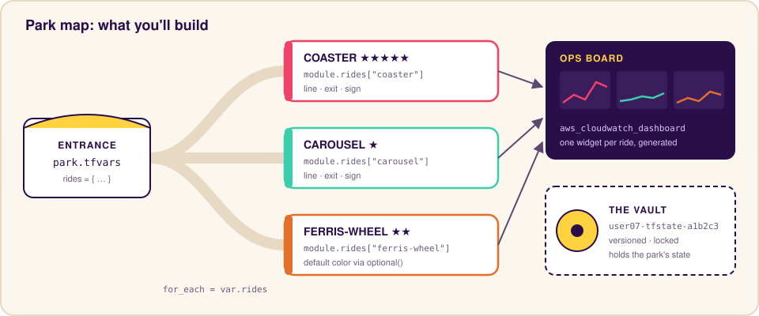
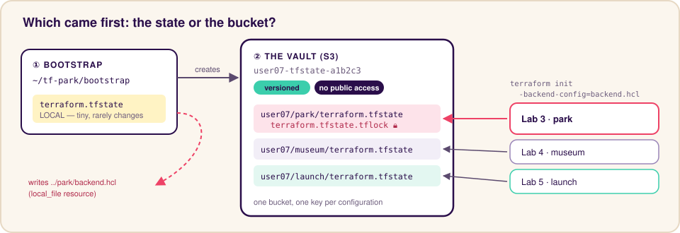
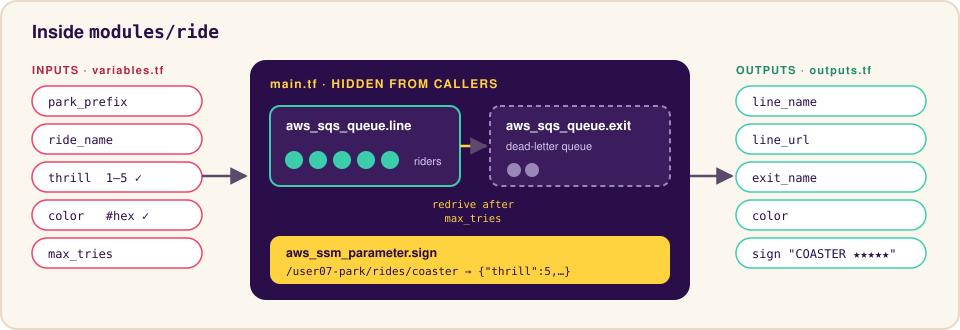
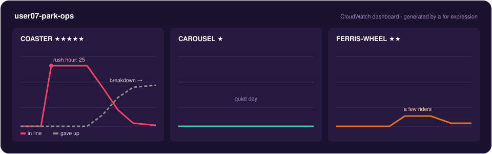

# Terraform Lab 3 — Theme Park Tycoon


## Welcome, Park Manager

In Labs 1 and 2, everything lived in one directory and one local state file. That's fine for one person on one laptop. It falls apart when a team shares the work, when the laptop dies, or when you need the same pattern ten times.

Today you'll build a **theme park** in AWS. Each ride has a line (an SQS queue), an exit for riders who give up (a dead-letter queue), and a sign at the entrance (a Parameter Store entry). On the way you'll learn the three skills that turn Terraform from a script into a team tool:

| Skill | The problem it solves | Field Guide |
|---|---|---|
| **Remote state + locking** | "My state is on my laptop" and "we both ran apply at once" | Sheet 15 |
| **Modules** | "I copy-pasted the same 40 lines for every ride" | Sheet 16 |
| **Complex types + `for_each` over modules** | "Adding a ride means editing code instead of data" | Sheets 13, 18 |

This lab is **guided**: every step shows the code. Read the *Why it matters* notes. That's where the insight is.

**Time:** ~60 minutes · **Cost:** a few cents (SQS, Parameter Store, and one CloudWatch dashboard)



---

## Shared Account Naming

Everything you create starts with your ID. Here's what's new in this lab and why the prefix matters:

| Resource | Your name | Must be unique across… |
|---|---|---|
| State bucket | `user07-tfstate-a1b2c3` | **Every AWS account worldwide** (so it gets a random suffix) |
| State file key | `user07/park/terraform.tfstate` | Your bucket (the `user07/` folder keeps it tidy) |
| SQS queues | `user07-park-coaster-line` | This account + Region |
| Parameter Store names | `/user07-park/rides/coaster` | This account + Region |
| CloudWatch dashboard | `user07-park-ops` | **This whole account** (dashboards are global) |

> Throughout this lab, replace `user07` with **your** ID.

---

## Part 1 — Build the Vault (12 min)

Your state needs a safe home that isn't your laptop: an S3 bucket with versioning (so every state change can be undone) and public access blocked.

But there's a chicken-and-egg problem: **Terraform needs a bucket to store state, and you want Terraform to create the bucket.** The standard answer is a tiny **bootstrap** configuration that keeps its own state locally and creates the bucket for everything else.



### Step 1.1 — Create the directories

```bash
mkdir -p ~/tf-park/bootstrap ~/tf-park/park/modules/ride
cd ~/tf-park/bootstrap
```

### Step 1.2 — Create `bootstrap/main.tf`

```hcl
terraform {
  required_version = ">= 1.10"

  required_providers {
    aws = {
      source  = "hashicorp/aws"
      version = "~> 6.0"
    }
    random = {
      source  = "hashicorp/random"
      version = "~> 3.6"
    }
    local = {
      source  = "hashicorp/local"
      version = "~> 2.5"
    }
  }
}

provider "aws" {
  region = "us-west-2"

  default_tags {
    tags = {
      Owner     = var.user_id
      Project   = "terraform-state"
      ManagedBy = "terraform"
    }
  }
}

variable "user_id" {
  description = "Your assigned ID, e.g. user07"
  type        = string

  validation {
    condition     = can(regex("^user[0-9]{2}$", var.user_id))
    error_message = "user_id must look like user07."
  }
}

resource "random_id" "suffix" {
  byte_length = 3
}

# The vault that will hold the state for every lab from here on
resource "aws_s3_bucket" "state" {
  bucket        = "${var.user_id}-tfstate-${random_id.suffix.hex}"
  force_destroy = true # lab only: production state buckets use prevent_destroy instead
}

resource "aws_s3_bucket_versioning" "state" {
  bucket = aws_s3_bucket.state.id

  versioning_configuration {
    status = "Enabled"
  }
}

resource "aws_s3_bucket_public_access_block" "state" {
  bucket = aws_s3_bucket.state.id

  block_public_acls       = true
  block_public_policy     = true
  ignore_public_acls      = true
  restrict_public_buckets = true
}

# Write the backend settings for the park so nobody has to copy-paste a bucket name
resource "local_file" "park_backend" {
  filename = "${path.module}/../park/backend.hcl"
  content  = <<-EOT
    bucket       = "${aws_s3_bucket.state.bucket}"
    key          = "${var.user_id}/park/terraform.tfstate"
    region       = "us-west-2"
    use_lockfile = true
  EOT
}

output "state_bucket" {
  value = aws_s3_bucket.state.bucket
}
```

> **Why it matters**
> - `random_id` makes the bucket name globally unique. `user07-tfstate` alone could already belong to a stranger.
> - **Versioning** means a corrupted or overwritten state file can be rolled back. It's the single most important setting on a state bucket.
> - The `local` provider writes a file on *your* machine. Terraform isn't only for clouds: here it generates the config the next step needs.

### Step 1.3 — Apply it

```bash
terraform init
terraform apply -var="user_id=user07"
```

Check the plan: **5 to add**. Type `yes`.

**✅ Checkpoint:** `cat ../park/backend.hcl` shows your bucket name and `key = "user07/park/terraform.tfstate"`.

---

## Part 2 — Open the Park Gates (10 min)

Now the park configuration, which stores its state **in the vault**.

### Step 2.1 — Create `park/main.tf`

```bash
cd ~/tf-park/park
```

```hcl
terraform {
  required_version = ">= 1.10"

  required_providers {
    aws = {
      source  = "hashicorp/aws"
      version = "~> 6.0"
    }
  }

  # Partial configuration: the details come from backend.hcl at init time
  backend "s3" {}
}

provider "aws" {
  region = "us-west-2"

  default_tags {
    tags = {
      Owner     = var.user_id
      Project   = "theme-park"
      ManagedBy = "terraform"
    }
  }
}

locals {
  park = "${var.user_id}-park"
}
```

> **Why `backend "s3" {}` is empty:** backend blocks **can't use variables**. They're read before anything else, even before variables exist. So you either hard-code the values (and nobody else can reuse your code), or leave the block empty and pass a file at init time. That's called **partial configuration**, and it's how real teams use one codebase with many state files.

### Step 2.2 — Create `park/variables.tf`

```hcl
variable "user_id" {
  description = "Your assigned ID, e.g. user07"
  type        = string

  validation {
    condition     = can(regex("^user[0-9]{2}$", var.user_id))
    error_message = "user_id must look like user07."
  }
}
```

### Step 2.3 — Initialize with the backend file

```bash
terraform init -backend-config=backend.hcl
```

Look for: `Successfully configured the backend "s3"!`

### Step 2.4 — Prove the backend works

```bash
terraform plan -var="user_id=user07"
```

You should see `No changes`. There's nothing in the park yet, but Terraform just read (empty) state from S3. You'll see the lock in action in Part 3, once there's something to apply.

**✅ Checkpoint:** `init` printed `Successfully configured the backend "s3"!` and the plan ran without errors.

---

## Part 3 — Build Your First Ride Module (15 min)

A ride needs three resources wired together correctly. You'll package them into a **module** so every ride is built the same way.



### Step 3.1 — `modules/ride/variables.tf` (the module's inputs)

```hcl
variable "park_prefix" {
  description = "Prefix shared by everything in the park, e.g. user07-park"
  type        = string
}

variable "ride_name" {
  description = "Short name of this ride, e.g. coaster"
  type        = string
}

variable "thrill" {
  description = "How intense the ride is, from 1 (gentle) to 5 (scream)"
  type        = number

  validation {
    condition     = var.thrill >= 1 && var.thrill <= 5 && floor(var.thrill) == var.thrill
    error_message = "thrill must be a whole number from 1 to 5."
  }
}

variable "color" {
  description = "Ride color used on the dashboard, as #rrggbb"
  type        = string

  validation {
    condition     = can(regex("^#[0-9a-fA-F]{6}$", var.color))
    error_message = "color must look like #e2702b."
  }
}

variable "max_tries" {
  description = "How many times a rider can be pulled from the line before giving up"
  type        = number

  validation {
    condition     = var.max_tries >= 1 && var.max_tries <= 10
    error_message = "max_tries must be between 1 and 10."
  }
}
```

### Step 3.2 — `modules/ride/main.tf` (the module's insides)

```hcl
locals {
  base  = "${var.park_prefix}-${var.ride_name}"
  stars = join("", [for i in range(var.thrill) : "★"])
}

# Riders who give up end up here (a dead-letter queue)
resource "aws_sqs_queue" "exit" {
  name                      = "${local.base}-exit"
  message_retention_seconds = 3600
}

# The line for the ride
resource "aws_sqs_queue" "line" {
  name                      = "${local.base}-line"
  message_retention_seconds = 3600

  redrive_policy = jsonencode({
    deadLetterTargetArn = aws_sqs_queue.exit.arn
    maxReceiveCount     = var.max_tries
  })

  tags = {
    Ride   = var.ride_name
    Thrill = tostring(var.thrill)
  }
}

# The sign at the entrance, readable by any app via Parameter Store
resource "aws_ssm_parameter" "sign" {
  name = "/${var.park_prefix}/rides/${var.ride_name}"
  type = "String"
  value = jsonencode({
    ride   = var.ride_name
    thrill = var.thrill
    color  = var.color
    line   = aws_sqs_queue.line.url
  })
}
```

### Step 3.3 — `modules/ride/outputs.tf` (what the module hands back)

```hcl
output "line_name" {
  value = aws_sqs_queue.line.name
}

output "line_url" {
  value = aws_sqs_queue.line.url
}

output "exit_name" {
  value = aws_sqs_queue.exit.name
}

output "color" {
  value = var.color
}

output "sign" {
  value = "${upper(var.ride_name)} ${local.stars}"
}
```

> **Why it matters:** the module has no `provider` block and no `user_id`. It doesn't know or care who's calling it. Everything it needs comes in through variables, and everything it shares goes out through outputs. That's what makes it reusable, and testable (Lab 4).

### Step 3.4 — Call the module once

Add to the bottom of `park/main.tf`:

```hcl
module "coaster" {
  source = "./modules/ride"

  park_prefix = local.park
  ride_name   = "coaster"
  thrill      = 5
  color       = "#ee4266"
  max_tries   = 3
}
```

```bash
terraform init          # new module: init again
terraform plan -var="user_id=user07"
```

Look at the addresses in the plan: `module.coaster.aws_sqs_queue.line`, `module.coaster.aws_ssm_parameter.sign`… Every resource now lives inside the module's namespace.

### Step 3.5 — Feel the lock 🔒

You need **two terminals**, both in `~/tf-park/park`.

1. **Terminal A:** `terraform apply -var="user_id=user07"`. It shows `Plan: 3 to add` and asks `Enter a value:`. **Don't answer yet.**
2. **Terminal B:** `terraform plan -var="user_id=user07"`

Terminal B fails:

```text
Error: Error acquiring the state lock
...
Lock Info:
  Path:      user07-tfstate-a1b2c3/user07/park/terraform.tfstate
  Operation: OperationTypeApply
  Who:       you@your-vm
```

While Terminal A is still waiting, peek at the lock file in your bucket:

```bash
aws s3 ls s3://<your-bucket>/user07/park/
```

You'll see `terraform.tfstate.tflock` next to the state.

3. In **Terminal A**, type `yes`. When the apply finishes, run the plan in Terminal B again: it works now, and the lock file is gone.

> **Why it matters:** two engineers (or two CI pipelines) can no longer apply at the same time and corrupt the state. The lock lives right next to the state, in the same bucket.

> **Note:** the lock is only held while there's work pending. An apply with nothing to change finishes immediately and never waits at the prompt.

Now check the sign:

```bash
aws ssm get-parameter --name /user07-park/rides/coaster --query Parameter.Value --output text
```

**✅ Checkpoint:** you see JSON with `"ride":"coaster"` and the line's URL.

---

## Part 4 — The Park Runs on Data (10 min)

Copying a `module` block for every ride is better than copying 40 lines of resources, but it's still copying. The real power move: describe the rides as **data**, and let `for_each` build one module instance per ride.

### Step 4.1 — Describe the rides with a typed map

Add to `park/variables.tf`:

```hcl
variable "rides" {
  description = "Every ride in the park, keyed by ride name"
  type = map(object({
    thrill    = number
    color     = optional(string, "#e2702b")
    max_tries = optional(number, 3)
  }))

  validation {
    condition     = alltrue([for name in keys(var.rides) : can(regex("^[a-z][a-z0-9-]{1,19}$", name))])
    error_message = "Ride names must be 2-20 characters: lowercase letters, digits, and dashes, starting with a letter."
  }
}
```

> **Why it matters:** `map(object({...}))` is a contract. Terraform rejects a ride with a missing `thrill` or a typo like `thril`. `optional(type, default)` lets riders skip fields and still get a sensible value.

### Step 4.2 — Create `park/park.tfvars`

```hcl
user_id = "user07"

rides = {
  coaster = {
    thrill = 5
    color  = "#ee4266"
  }
  carousel = {
    thrill = 1
    color  = "#3bceac"
  }
  ferris-wheel = {
    thrill = 2
  }
}
```

### Step 4.3 — Replace the single module call

In `park/main.tf`, **delete** `module "coaster" { ... }` and add:

```hcl
module "rides" {
  source   = "./modules/ride"
  for_each = var.rides

  park_prefix = local.park
  ride_name   = each.key
  thrill      = each.value.thrill
  color       = each.value.color
  max_tries   = each.value.max_tries
}

# The coaster you already built now lives at a new address
moved {
  from = module.coaster
  to   = module.rides["coaster"]
}
```

### Step 4.4 — Plan, and read carefully

```bash
terraform plan -var-file=park.tfvars
```

You should see:

```text
  # module.coaster.aws_sqs_queue.line has moved to module.rides["coaster"].aws_sqs_queue.line
  ...
Plan: 6 to add, 0 to change, 0 to destroy.
```

The coaster **moves**. Only the carousel and ferris wheel (3 resources each) are new.

> **Predict, then try:** delete the `moved` block and plan again. What happens to the coaster? Put the block back before you apply.

Apply it, then:

```bash
terraform output ride_signs
```

Add `park/outputs.tf` first if you want that output:

```hcl
output "ride_signs" {
  description = "The sign at the entrance of each ride"
  value       = { for name, ride in module.rides : name => ride.sign }
}

output "ride_lines" {
  description = "SQS queue name for each ride's line"
  value       = { for name, ride in module.rides : name => ride.line_name }
}
```

**✅ Checkpoint:** `ride_signs` shows `COASTER ★★★★★`, `CAROUSEL ★`, and `FERRIS-WHEEL ★★`.

### Step 4.5 — Add a ride without touching code

Add one more ride to `park.tfvars` (be creative: `log-flume`, `haunted-house`, `drop-tower`…) and plan. **Only `park.tfvars` changed**, and only the new ride's 3 resources appear. Apply it.

---

## Part 5 — Ops Board & Rush Hour (10 min)

A park manager needs a control room. You'll build a CloudWatch dashboard with **one widget per ride**, generated from the same data.



### Step 5.1 — Add the dashboard to `park/main.tf`

```hcl
resource "aws_cloudwatch_dashboard" "ops" {
  dashboard_name = "${local.park}-ops"

  dashboard_body = jsonencode({
    widgets = [
      for i, name in sort(keys(module.rides)) : {
        type   = "metric"
        x      = (i % 3) * 8
        y      = floor(i / 3) * 6
        width  = 8
        height = 6
        properties = {
          title  = module.rides[name].sign
          region = "us-west-2"
          stat   = "Maximum"
          period = 60
          view   = "timeSeries"
          metrics = [
            ["AWS/SQS", "ApproximateNumberOfMessagesVisible", "QueueName", module.rides[name].line_name, { color = module.rides[name].color, label = "in line" }],
            ["AWS/SQS", "ApproximateNumberOfMessagesVisible", "QueueName", module.rides[name].exit_name, { color = "#7f7f7f", label = "gave up" }],
          ]
        }
      }
    ]
  })
}

output "dashboard_url" {
  value = "https://us-west-2.console.aws.amazon.com/cloudwatch/home?region=us-west-2#dashboards/dashboard/${aws_cloudwatch_dashboard.ops.dashboard_name}"
}
```

> **Why it matters:** the `for` expression lays out a grid: `(i % 3) * 8` gives columns 0, 8, 16, and `floor(i / 3) * 6` starts a new row every three rides. Add a ride and the dashboard rearranges itself. No JSON is written by hand.

Apply, then open the `dashboard_url` output.

### Step 5.2 — Rush hour: send riders into the coaster line

```bash
Q=$(aws sqs get-queue-url --queue-name user07-park-coaster-line --query QueueUrl --output text)
for i in $(seq 1 25); do aws sqs send-message --queue-url "$Q" --message-body "rider-$i" > /dev/null; done
```

### Step 5.3 — The ride breaks down

Riders keep getting pulled from the line, but the ride never actually runs (nobody deletes the messages). After `max_tries` attempts, they give up and walk to the exit:

```bash
for i in $(seq 1 30); do
  aws sqs receive-message --queue-url "$Q" --max-number-of-messages 10 --visibility-timeout 0 > /dev/null
done
```

Wait 2–3 minutes and refresh the dashboard (metrics arrive about once a minute).

**✅ Checkpoint:** the coaster widget shows riders moving from "in line" to "gave up".

> **Why it matters:** the dead-letter queue pattern is everywhere in real systems: a message that keeps failing gets parked instead of blocking everyone behind it. You wired it with one `redrive_policy`, and the module gives every ride the same safety net for free.

---

## Part 6 — Closing Time (3 min)

```bash
cd ~/tf-park/park
terraform destroy -var-file=park.tfvars
```

> **Keep the vault!** Labs 4 and 5 store their state in the same bucket under different keys. Only destroy `bootstrap` when you're finished with all the labs:
>
> ```bash
> cd ~/tf-park/bootstrap && terraform destroy -var="user_id=user07"
> ```

**✅ Checkpoint:** `aws sqs list-queues --queue-name-prefix user07-park` returns nothing.

---

## Lab 3 Debrief

| You did | The concept |
|---|---|
| Created a versioned state bucket with its own local-state config | Bootstrapping remote state |
| `backend "s3" {}` + `-backend-config=backend.hcl` | Partial backend configuration |
| Saw `Error acquiring the state lock` | State locking with `use_lockfile` |
| Packaged 3 resources behind inputs and outputs | Modules |
| `map(object({ ... optional(...) }))` | Complex types with defaults |
| `for_each` on a `module` block | Module instances from data |
| `moved { from = module.coaster ... }` | Refactoring without rebuilding |
| Generated dashboard JSON with `for` | Expressions that build structure |

**Next up — Lab 4:** someone built things in the console behind your back. You'll adopt them into Terraform, refactor them safely, and write tests that run without touching AWS.
