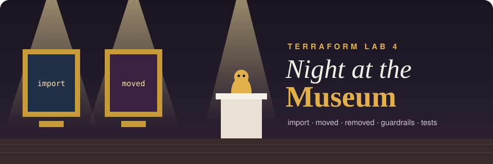
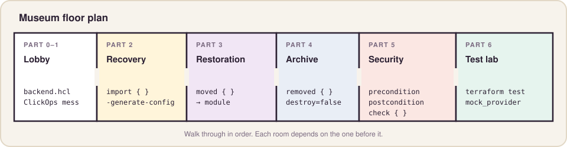
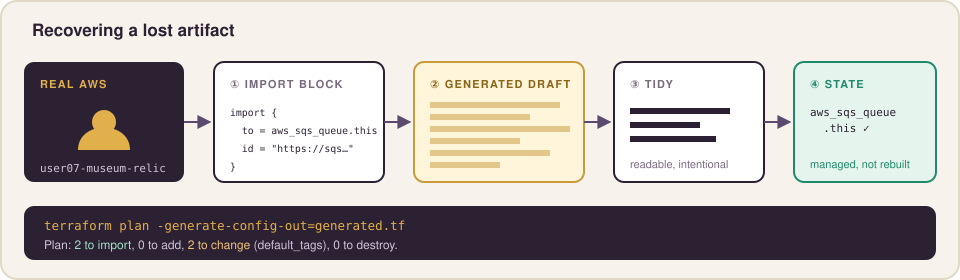
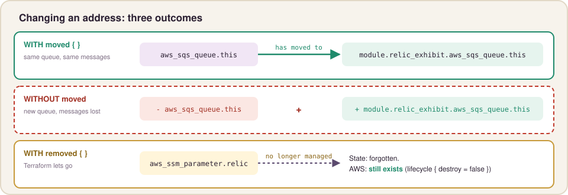
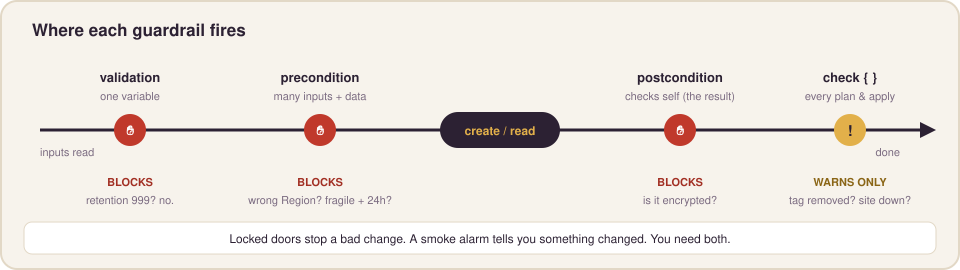
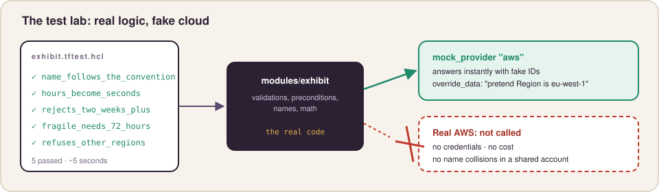

# Terraform Lab 4 — Night at the Museum



## The Case

It's after hours at the **Museum of Lost Infrastructure**. A previous curator built exhibits by clicking around the AWS Console. There's no code, no state, and no record. Your job:

1. **Recover** the lost artifacts into Terraform without rebuilding them.
2. **Reorganize** the collection (rename things, move them into a module) without breaking anything.
3. **Deaccession** one artifact: stop managing it without destroying it.
4. **Install alarms** that block bad deployments and warn about tampering.
5. **Test** your exhibit module without touching AWS at all.

These are the skills that separate "I can write Terraform" from "I can safely maintain Terraform that's already running in production."

| Skill | Block / command | Field Guide |
|---|---|---|
| Adopt existing resources | `import { }` + `-generate-config-out` | Sheet 20 |
| Rename without rebuilding | `moved { }` | Sheet 21 |
| Stop managing without deleting | `removed { }` | Sheet 21 |
| Guardrails | `precondition`, `postcondition`, `check { }` | Sheet 22 |
| Tests | `terraform test`, `mock_provider` | Sheet 23 |

**Time:** ~60 minutes · **Cost:** effectively free (two SQS queues and a parameter) · **Needs:** your state bucket from Lab 3



---

## Shared Account Naming

| Thing | Your name | Unique across… |
|---|---|---|
| SQS queue | `user07-museum-relic` | This account + Region |
| SSM parameter | `/user07-museum/relic` | This account + Region |
| State key | `user07/museum/terraform.tfstate` | Your state bucket |

Set your ID once for this terminal session, and use it everywhere:

```bash
export ID=user07   # <-- your ID
```

---

## Part 0 — Open the Museum (5 min)

```bash
mkdir -p ~/tf-museum/modules/exhibit/tests && cd ~/tf-museum
```

Point this configuration at a **new key** in the state bucket you built in Lab 3:

```bash
BUCKET=$(terraform -chdir=$HOME/tf-park/bootstrap output -raw state_bucket)
cat > backend.hcl <<EOF
bucket       = "$BUCKET"
key          = "$ID/museum/terraform.tfstate"
region       = "us-west-2"
use_lockfile = true
EOF
cat backend.hcl
```

> Destroyed your bootstrap already? Re-run `terraform apply` in `~/tf-park/bootstrap` first. You'll get a new bucket name, and that's fine.

> **Why it matters:** one state bucket, many keys. The park and the museum are separate state files, so a mistake in one can't touch the other. This is how teams split infrastructure into small, safe pieces.

Create `main.tf`:

```hcl
terraform {
  required_version = ">= 1.10"

  required_providers {
    aws = {
      source  = "hashicorp/aws"
      version = "~> 6.0"
    }
  }

  backend "s3" {}
}

provider "aws" {
  region = "us-west-2"

  default_tags {
    tags = {
      Owner     = var.user_id
      Project   = "museum"
      ManagedBy = "terraform"
    }
  }
}

variable "user_id" {
  type = string

  validation {
    condition     = can(regex("^user[0-9]{2}$", var.user_id))
    error_message = "user_id must look like user07."
  }
}
```

And `museum.tfvars`:

```hcl
user_id = "user07"
```

```bash
terraform init -backend-config=backend.hcl
```

---

## Part 1 — The Previous Curator's Mess (3 min)

Play the part of the previous curator. Create two "lost artifacts" outside Terraform:

```bash
aws sqs create-queue --queue-name $ID-museum-relic --tags Exhibit=relic
aws ssm put-parameter --name /$ID-museum/relic --type String --value "golden-idol" --tags Key=Exhibit,Value=relic
```

They exist in AWS, but Terraform doesn't know about them:

```bash
terraform state list        # (nothing)
```

---

## Part 2 — Recover the Artifacts (12 min)



### Step 2.1 — Write import blocks

An `import` block says: "this real object should belong to this address." Each resource type has its own ID format, documented at the bottom of its provider page. For an SQS queue it's the **queue URL**; for a parameter it's the **name**.

```bash
aws sqs get-queue-url --queue-name $ID-museum-relic --query QueueUrl --output text
```

Create `imports.tf` (paste your real queue URL):

```hcl
import {
  to = aws_sqs_queue.this
  id = "https://sqs.us-west-2.amazonaws.com/123456789012/user07-museum-relic"
}

import {
  to = aws_ssm_parameter.relic
  id = "/user07-museum/relic"
}
```

### Step 2.2 — Let Terraform write the code for you

```bash
terraform plan -var-file=museum.tfvars -generate-config-out=generated.tf
```

Terraform reads the real objects and writes **`generated.tf`** with matching resource blocks. Open it.

It's noisy: every argument at its current value, including many defaults. That's normal. Generated config is a **first draft**, not finished code.

### Step 2.3 — Tidy the generated code

Replace the contents of `generated.tf` with clean versions. Keep only what you'd want a human to read:

```hcl
resource "aws_sqs_queue" "this" {
  name                      = "${var.user_id}-museum-relic"
  message_retention_seconds = 345600

  tags = {
    Exhibit = "relic"
  }
}

resource "aws_ssm_parameter" "relic" {
  name  = "/${var.user_id}-museum/relic"
  type  = "String"
  value = "golden-idol"

  tags = {
    Exhibit = "relic"
  }
}
```

> **Watch for:** generated config writes sensitive values as `null # sensitive`. Terraform can't print the parameter's value, so you have to put the real value back yourself (`aws ssm get-parameter --name /$ID-museum/relic`).

### Step 2.4 — Plan the import

```bash
terraform plan -var-file=museum.tfvars
```

```text
Plan: 2 to import, 0 to add, 2 to change, 0 to destroy.
```

Why **2 to change**? Look at the `tags_all` lines. Your `default_tags` (`Owner`, `Project`, `ManagedBy`) are being added to the imported artifacts. Import adopts the object, and the same apply brings it up to your standards. Nothing is destroyed or re-created.

Apply it. Then **delete `imports.tf`**. Import blocks are a one-time instruction; once the object is in state, they've done their job.

**✅ Checkpoint:** `terraform state list` shows both resources, and a fresh `terraform plan -var-file=museum.tfvars` says `No changes`.

---

## Part 3 — Reorganize the Collection (10 min)

`aws_sqs_queue.this` is a lazy name. And every future exhibit will need the same settings, so it belongs in a module. Renaming a resource or moving it into a module changes its **address**. Without help, Terraform would destroy the old address and create a new one: a brand-new queue, with every message in it lost.



### Step 3.1 — Rename with `moved`

In `generated.tf`, rename `resource "aws_sqs_queue" "this"` to `resource "aws_sqs_queue" "relic"`. Then add to `main.tf`:

```hcl
moved {
  from = aws_sqs_queue.this
  to   = aws_sqs_queue.relic
}
```

```bash
terraform plan -var-file=museum.tfvars
```

```text
  # aws_sqs_queue.this has moved to aws_sqs_queue.relic
Plan: 0 to add, 0 to change, 0 to destroy.
```

> **Predict, then try:** comment out the `moved` block and plan. Read the destroy count. Then uncomment it.

### Step 3.2 — Build the exhibit module

`modules/exhibit/variables.tf`:

```hcl
variable "owner" {
  description = "ID of the curator who owns this exhibit, e.g. user07"
  type        = string

  validation {
    condition     = can(regex("^user[0-9]{2}$", var.owner))
    error_message = "owner must look like user07."
  }
}

variable "exhibit" {
  description = "Short exhibit name, e.g. relic"
  type        = string

  validation {
    condition     = can(regex("^[a-z][a-z0-9-]{1,20}$", var.exhibit))
    error_message = "exhibit must be 2-21 lowercase letters, digits, or dashes."
  }
}

variable "retention_hours" {
  description = "How long messages stay in the exhibit queue (1-336 hours)"
  type        = number
  default     = 96

  validation {
    condition     = var.retention_hours >= 1 && var.retention_hours <= 336
    error_message = "retention_hours must be between 1 and 336 (SQS allows up to 14 days)."
  }
}

variable "fragile" {
  description = "Fragile exhibits must keep messages at least 72 hours"
  type        = bool
  default     = false
}
```

`modules/exhibit/main.tf` (you'll add guardrails here in Part 5):

```hcl
terraform {
  required_providers {
    aws = {
      source  = "hashicorp/aws"
      version = "~> 6.0"
    }
  }
}

locals {
  name = "${var.owner}-museum-${var.exhibit}"
}

resource "aws_sqs_queue" "this" {
  name                      = local.name
  message_retention_seconds = var.retention_hours * 3600

  tags = {
    Exhibit = var.exhibit
  }
}
```

`modules/exhibit/outputs.tf`:

```hcl
output "name" {
  value = aws_sqs_queue.this.name
}

output "url" {
  value = aws_sqs_queue.this.url
}

output "arn" {
  value = aws_sqs_queue.this.arn
}
```

### Step 3.3 — Move the relic into the module

1. **Delete** the `aws_sqs_queue.relic` resource block from `generated.tf`.
2. Add to `main.tf`:

```hcl
module "relic_exhibit" {
  source = "./modules/exhibit"

  owner           = var.user_id
  exhibit         = "relic"
  retention_hours = 96
  fragile         = true
}

moved {
  from = aws_sqs_queue.relic
  to   = module.relic_exhibit.aws_sqs_queue.this
}
```

```bash
terraform init      # new module
terraform plan -var-file=museum.tfvars
```

**✅ Checkpoint:** the plan says `has moved to module.relic_exhibit.aws_sqs_queue.this` and **0 to add, 0 to change, 0 to destroy**. (345,600 seconds is exactly 96 hours, so nothing changes.) Apply it to record the move.

> **Why it matters:** keep `moved` blocks in your code for a while after you apply them. Teammates and other environments that haven't applied yet need them too. They're a permanent, reviewable record of the refactor, unlike the old `terraform state mv` command, which changed state silently.

---

## Part 4 — Deaccession the Parameter (5 min)

The museum is handing the golden-idol parameter over to another team. Terraform should **stop managing it**, but it must **not be deleted**.

1. Delete the `aws_ssm_parameter.relic` resource block from `generated.tf` (the file should now be empty; you can delete it).
2. Add to `main.tf`:

```hcl
removed {
  from = aws_ssm_parameter.relic

  lifecycle {
    destroy = false
  }
}
```

```bash
terraform plan -var-file=museum.tfvars
```

```text
  # aws_ssm_parameter.relic will no longer be managed by Terraform
Plan: 0 to add, 0 to change, 0 to destroy.
```

Apply it, then prove the parameter survived:

```bash
aws ssm get-parameter --name /$ID-museum/relic --query Parameter.Value --output text
```

**✅ Checkpoint:** it still prints `golden-idol`, and `terraform state list` no longer lists it.

> **Predict, then try:** what would the plan say if you had *only* deleted the resource block, with no `removed` block?

---

## Part 5 — Install the Alarms (12 min)

Variable `validation` checks one input at a time. Real rules are often bigger than that:



### Step 5.1 — Preconditions and a postcondition

In `modules/exhibit/main.tf`, add a data source above the queue:

```hcl
data "aws_region" "current" {}
```

…and a `lifecycle` block **inside** `resource "aws_sqs_queue" "this"`, after the `tags`:

```hcl
  lifecycle {
    precondition {
      condition     = data.aws_region.current.region == "us-west-2"
      error_message = "The museum only opens exhibits in us-west-2."
    }

    precondition {
      condition     = !var.fragile || var.retention_hours >= 72
      error_message = "Fragile exhibits must keep messages for at least 72 hours."
    }

    postcondition {
      condition     = self.sqs_managed_sse_enabled
      error_message = "Exhibit queues must be encrypted at rest."
    }
  }
```

| Check | When it runs | What it's for |
|---|---|---|
| `precondition` (Region) | Before the resource is planned | Facts about the **world** (where am I deploying?) |
| `precondition` (fragile) | Before the resource is planned | Rules that involve **several inputs** |
| `postcondition` | After the resource is read or created | Guarantees about the **result** (`self`) |

Try to break it: in `main.tf`, set `retention_hours = 24` for the relic and plan. You'll get your fragile-exhibit error. Set it back to `96`.

### Step 5.2 — A standing guard with `check`

Preconditions **block**. Sometimes you only want a **warning**, especially for things outside your control. Add to `main.tf`:

```hcl
check "relic_still_labeled" {
  data "aws_sqs_queue" "relic_live" {
    name = module.relic_exhibit.name
  }

  assert {
    condition     = lookup(data.aws_sqs_queue.relic_live.tags, "Owner", "") == var.user_id
    error_message = "Someone removed the Owner tag from ${module.relic_exhibit.name}!"
  }
}

output "relic_queue" {
  value = module.relic_exhibit.url
}
```

Apply. Now play the vandal and strip the tag from **your own** queue:

```bash
Q=$(aws sqs get-queue-url --queue-name $ID-museum-relic --query QueueUrl --output text)
aws sqs untag-queue --queue-url "$Q" --tag-keys Owner
terraform plan -var-file=museum.tfvars
```

**✅ Checkpoint:** the plan shows `Warning: Check block assertion failed … Someone removed the Owner tag…`, **and** a `~ tags_all` change that will put the tag back. Apply to restore it.

> **Why it matters:** a `check` block runs on every plan and apply, but never stops them. It's a smoke alarm, not a locked door. Teams use checks for "is the site up?", "is the certificate expiring?", and "did someone tamper with this?"

---

## Part 6 — Test Without Touching AWS (12 min)

Every plan so far has called real AWS APIs. In a shared account, you want to test your module's **logic** (names, conversions, guardrails) without creating anything. That's `terraform test` with a **mock provider**.



### Step 6.1 — Write the tests

Create `modules/exhibit/tests/exhibit.tftest.hcl`:

```hcl
# Runs entirely offline: the AWS provider is replaced by a mock.
mock_provider "aws" {
  override_data {
    target = data.aws_region.current
    values = {
      region = "us-west-2"
    }
  }
}

variables {
  owner   = "user07"
  exhibit = "vase"
}

run "name_follows_the_convention" {
  command = plan

  assert {
    condition     = aws_sqs_queue.this.name == "user07-museum-vase"
    error_message = "Expected user07-museum-vase, got ${aws_sqs_queue.this.name}."
  }
}

run "hours_become_seconds" {
  command = plan

  variables {
    retention_hours = 48
  }

  assert {
    condition     = aws_sqs_queue.this.message_retention_seconds == 172800
    error_message = "48 hours should be 172800 seconds."
  }
}

run "rejects_two_weeks_plus" {
  command = plan

  variables {
    retention_hours = 999
  }

  expect_failures = [var.retention_hours]
}

run "fragile_needs_72_hours" {
  command = plan

  variables {
    fragile         = true
    retention_hours = 24
  }

  expect_failures = [aws_sqs_queue.this]
}

run "refuses_other_regions" {
  command = plan

  override_data {
    target = data.aws_region.current
    values = {
      region = "eu-west-1"
    }
  }

  expect_failures = [aws_sqs_queue.this]
}
```

### Step 6.2 — Run them

```bash
cd ~/tf-museum/modules/exhibit
terraform init
terraform test
```

```text
tests/exhibit.tftest.hcl... in progress
  run "name_follows_the_convention"... pass
  run "hours_become_seconds"... pass
  run "rejects_two_weeks_plus"... pass
  run "fragile_needs_72_hours"... pass
  run "refuses_other_regions"... pass
tests/exhibit.tftest.hcl... pass

Success! 5 passed, 0 failed.
```

**✅ Checkpoint:** 5 passed. To prove the tests can catch something, change `* 3600` to `* 60` in the module and run `terraform test` again. Then change it back.

> **Why it matters:**
> - `mock_provider` fakes every AWS call, so these tests need **no credentials**, cost nothing, and can't collide with anyone in a shared account.
> - `override_data` pins a data source to a value, so you can test "what if we were in the wrong Region?" without going there.
> - `expect_failures` turns "this *should* be rejected" into a passing test. Guardrails deserve tests too.
> - These run in seconds in CI on every pull request.

---

## Part 7 — Close the Museum (3 min)

```bash
cd ~/tf-museum
terraform destroy -var-file=museum.tfvars
```

The parameter isn't in state anymore (you deaccessioned it), so delete it by hand:

```bash
aws ssm delete-parameter --name /$ID-museum/relic
```

Keep your state bucket for Lab 5.

**✅ Checkpoint:** `aws sqs list-queues --queue-name-prefix $ID-museum` returns nothing.

---

## Troubleshooting

| Symptom | Fix |
|---|---|
| `Cannot import non-existent remote object` | The ID is wrong. SQS imports use the full **queue URL**, not the name. |
| `-generate-config-out` says the file already exists | Delete `generated.tf` and run it again; Terraform won't overwrite it. |
| Generated SSM block has `value = null # sensitive` | Replace with the real value from `aws ssm get-parameter`. |
| Postcondition: `Exhibit queues must be encrypted at rest` | Your queue was created without SSE. Run `aws sqs set-queue-attributes --queue-url "$Q" --attributes SqsManagedSseEnabled=true` and plan again. The guardrail did its job! |
| `terraform test` asks for credentials | You're in `~/tf-museum`, not `modules/exhibit`, or the `mock_provider` block is missing. |

---

## Lab 4 Debrief

| You did | The concept |
|---|---|
| `import {}` + `-generate-config-out` | Adopt ClickOps resources without rebuilding |
| Saw "2 to change" on import | Import + `default_tags` brings old resources up to standard |
| `moved {}` twice | Rename and modularize with zero downtime |
| `removed { lifecycle { destroy = false } }` | Hand off a resource without deleting it |
| `precondition` / `postcondition` | Block bad deployments, verify results |
| `check {}` | Continuous warnings that never block |
| `terraform test` + `mock_provider` | Fast, free, offline tests of module logic |

**Next up — Lab 5:** no more step-by-step. You'll build a blue/green launch with weighted traffic and ship a new version with zero downtime.
