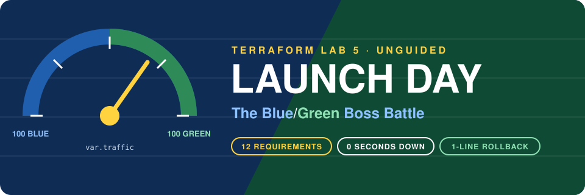
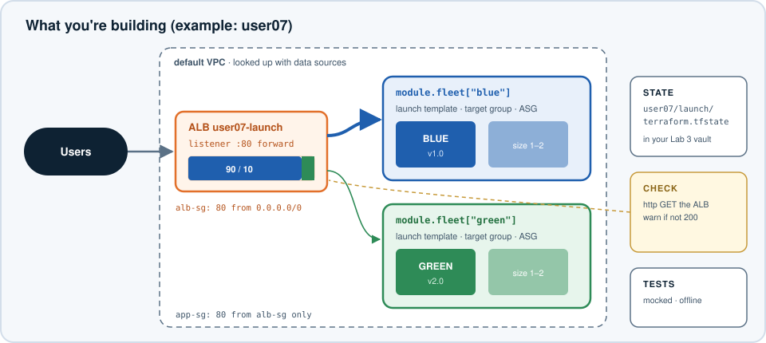
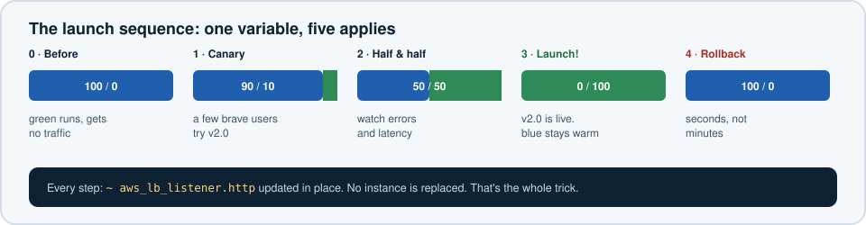

# Terraform Lab 5 — Launch Day: The Blue/Green Boss Battle



## Your Mission

Your company is shipping **version 2.0** of its website today. The last release was done by replacing servers in place, and the site was down for eleven minutes. Leadership wants **zero downtime** and an instant undo button.

You'll use **blue/green deployment**: run the old version (blue) and the new version (green) side by side behind one load balancer, then turn a **traffic dial** from 100% blue to 100% green. If anything looks wrong, turn it back.

This lab is **unguided**. You get requirements, acceptance checks, and a stack of hints. Everything you need was covered in Labs 1–4 and the Field Guide. One new technique, `dynamic` blocks, is introduced below.

**Time:** 60–75 minutes · **Cost:** under $0.20 (one ALB + 2–4 `t3.micro` for an hour)



---

## The One New Concept: `dynamic` Blocks

Some resources take **repeated nested blocks**. An ALB listener that forwards to several target groups looks like this:

```hcl
forward {
  target_group {
    arn    = "arn:...:targetgroup/blue/..."
    weight = 90
  }
  target_group {
    arn    = "arn:...:targetgroup/green/..."
    weight = 10
  }
}
```

You can't put `for_each` on a nested block directly. Instead, a `dynamic` block **generates** one nested block per element:

```hcl
forward {
  dynamic "target_group" {
    for_each = module.fleet               # one block per fleet
    content {
      arn    = target_group.value.target_group_arn
      weight = var.traffic[target_group.key]
    }
  }
}
```

Inside `content`, the iterator is named after the block (`target_group`), with `.key` and `.value`. See Field Guide sheet 19, and sheet 24 for the blue/green pattern itself.

> **Use with taste:** `dynamic` blocks make code harder to read. Use them when the *number* of nested blocks really varies with your data, like here.

---

## Requirements

Build it in a new directory, `~/tf-launch`. Tick each one off as you go.

### Foundation

- **R1 — Remote state.** State lives in your Lab 3 bucket under the key `<id>/launch/terraform.tfstate`, with locking.
- **R2 — Naming & tags.** Every name starts with `<id>-launch`. Every resource carries `Owner`, `Project = "launch-day"`, and `ManagedBy = "terraform"` tags without you repeating them.
- **R3 — Network lookups.** Use the shared **default VPC** and its subnets through data sources. Create no VPCs or subnets.

### The fleets

- **R4 — A `fleet` module.** `modules/fleet` creates, for one color: a launch template, a target group, and an Auto Scaling group registered with that target group. Inputs include at least the color name, hex color, app version, and size.
- **R5 — Fleets from data.** The root config calls the module with `for_each` over a variable `fleets`: a map of objects with `hex`, `version`, and an optional `size` (default `1`). Reject fleet sizes above 2.
- **R6 — The page.** Each instance serves:
  - `/` — a full-screen page in the fleet's color showing the color name and version
  - `/color.txt` — plain text such as `blue v1.0` (for health checks and for counting)

### The front door

- **R7 — Chained security groups.** The ALB accepts HTTP 80 from anywhere. Instances accept HTTP 80 **only from the ALB's security group**.
- **R8 — The traffic dial.** One ALB with one HTTP listener whose default action **forwards** to every fleet's target group with weights from a variable `traffic` (a `map(number)`). Use a `dynamic` block.
- **R9 — Dial safety.** `traffic` validation rejects weights that don't add up to **100**, and any traffic map whose keys don't match `fleets` exactly.

### Confidence

- **R10 — A health check that never blocks.** A `check` block fetches the ALB URL with the `hashicorp/http` provider and warns if it isn't HTTP 200.
- **R11 — Offline tests.** `terraform test` with mock providers proves, at least, that names are prefixed, weights add up to 100, and bad dials are rejected. No AWS calls.
- **R12 — Useful outputs.** At minimum, the site URL and a one-line command that samples 20 requests and counts colors.

---

## Acceptance: The Launch Sequence

When all requirements are met, run the launch. Each step is just a `traffic` change in your `.tfvars` and an `apply`.



| Step | `traffic` | You should see |
|---|---|---|
| 0. Before launch | `{ blue = 100, green = 0 }` | Only blue. Green is running but gets no traffic. |
| 1. Canary | `{ blue = 90, green = 10 }` | Roughly 2 green in 20 requests |
| 2. Half and half | `{ blue = 50, green = 50 }` | Roughly 10 and 10 |
| 3. Launch! | `{ blue = 0, green = 100 }` | Only green |
| 4. "Something's wrong!" | `{ blue = 100, green = 0 }` | Instant rollback to blue |

Count colors with something like:

```bash
for i in $(seq 1 20); do curl -s http://<your-alb-dns>/color.txt; done | sort | uniq -c
```

At every step, `terraform plan` should show **only the listener changing** (`~ update in-place`). No instance should be replaced. That's the whole point.

**🏆 Boss defeated when:** all 12 requirements are met, `terraform test` passes, and you've run steps 0–4 with only the listener changing.

---

## Hints

Open them as you need them. Each requirement has a nudge first and something more concrete second.

<details>
<summary>R1 — Remote state</summary>

Same as Lab 4: an empty `backend "s3" {}` block, plus a `backend.hcl` with your bucket, the key `user07/launch/terraform.tfstate`, the Region, and `use_lockfile = true`. Then `terraform init -backend-config=backend.hcl`.

```bash
terraform -chdir=$HOME/tf-park/bootstrap output -raw state_bucket
```
</details>

<details>
<summary>R2 — Names and tags</summary>

A local such as `prefix = "${var.user_id}-launch"`, and `default_tags` in the provider block. Watch the **32-character limit** on ALB and target group names: `user07-launch-green` is 19 characters, so you're fine. Don't add a long suffix.
</details>

<details>
<summary>R3 — Default VPC</summary>

`data "aws_vpc"` with `default = true`, then `data "aws_subnets"` filtered on `vpc-id`. You did exactly this in Lab 1. An ALB needs subnets in **at least two** Availability Zones; the default VPC has one per AZ.
</details>

<details>
<summary>R4 — The fleet module (nudge)</summary>

Pass in everything the module can't look up for itself: VPC ID, subnet IDs, AMI ID, the app security group ID, and a name prefix. Output at least the target group ARN.
</details>

<details>
<summary>R4 — The fleet module (more)</summary>

- `aws_launch_template`: `image_id`, `instance_type = "t3.micro"`, `vpc_security_group_ids`, and `user_data`. Launch templates need user data **base64-encoded**: `base64encode(templatefile(...))`.
- `aws_lb_target_group`: `port = 80`, `protocol = "HTTP"`, `vpc_id`, and a `health_check` with `path = "/color.txt"`. A short `interval` (10) and `deregistration_delay` (15) make the lab snappier.
- `aws_autoscaling_group`: `min_size = max_size = desired_capacity = var.size`, `vpc_zone_identifier`, `target_group_arns = [aws_lb_target_group.this.arn]`, `health_check_type = "ELB"`, and a `launch_template { id = ..., version = aws_launch_template.this.latest_version }` block.
</details>

<details>
<summary>R5 — Fleets as data</summary>

```hcl
variable "fleets" {
  type = map(object({
    hex     = string
    version = string
    size    = optional(number, 1)
  }))
}
```

A validation can loop over all fleets: `alltrue([for name, f in var.fleets : f.size <= 2])`.
</details>

<details>
<summary>R6 — The page</summary>

Reuse the pattern from Lab 2's beacon. `dnf install -y httpd`, write `/var/www/html/index.html`, and add:

```bash
echo "${color_name} v${app_version}" > /var/www/html/color.txt
```

Remember: inside a `.tftpl` file, every `${...}` is Terraform's. Bash variables must be written as `$VAR` (no braces).
</details>

<details>
<summary>R7 — Security group chaining</summary>

Same idea as the VPC Escape Room's Room 2, in Terraform: `aws_vpc_security_group_ingress_rule` with `referenced_security_group_id = aws_security_group.alb.id` instead of `cidr_ipv4`. Instances also need **egress** to the internet so `dnf` can install `httpd`. Default VPC subnets give instances a public IP, so no NAT gateway is needed.
</details>

<details>
<summary>R8 — The listener</summary>

`aws_lb_listener` with `port = 80`, `protocol = "HTTP"`, and:

```hcl
default_action {
  type = "forward"
  forward {
    dynamic "target_group" {
      for_each = module.fleet
      content {
        arn    = ______
        weight = ______
      }
    }
  }
}
```

`module.fleet` is a map of module instances keyed by color, so `target_group.key` is `"blue"` or `"green"`.
</details>

<details>
<summary>R9 — Dial safety</summary>

Since Terraform 1.9, a variable's validation can reference **other variables**:

```hcl
validation {
  condition     = sum(values(var.traffic)) == 100
  error_message = "Traffic weights must add up to 100."
}

validation {
  condition     = toset(keys(var.traffic)) == toset(keys(var.fleets))
  error_message = "Every fleet needs a traffic weight, and every weight needs a fleet."
}
```
</details>

<details>
<summary>R10 — The check block</summary>

Add `hashicorp/http` to `required_providers` (re-run `init`!). Then:

```hcl
check "launch_site_answers" {
  data "http" "site" {
    url = "http://${aws_lb.this.dns_name}/"
  }

  assert {
    condition     = data.http.site.status_code == 200
    error_message = "______"
  }
}
```

Right after the first apply the check will probably warn, because the instances are still installing `httpd`. That's correct behavior. Run `terraform plan` two minutes later and it's quiet.
</details>

<details>
<summary>R11 — Tests (nudge)</summary>

Put tests in `tests/launch.tftest.hcl` next to your root `main.tf`. You need `mock_provider "aws" {}` and `mock_provider "http" {}`, and `run` blocks. For the "bad dial" cases, `command = plan` with `expect_failures = [var.traffic]`.
</details>

<details>
<summary>R11 — Tests (the gotchas you will hit)</summary>

Mock providers invent random strings for computed values. Some resources **validate** the format of their inputs, so you'll see errors like `"launch_template.0.id" must begin with 'lt-'` or `invalid ARN`. Give the mocks realistic defaults:

```hcl
mock_provider "aws" {
  mock_resource "aws_launch_template" {
    defaults = { id = "lt-0123456789abcdef0" }
  }
  mock_resource "aws_lb" {
    defaults = {
      arn      = "arn:aws:elasticloadbalancing:us-west-2:123456789012:loadbalancer/app/x/0123456789abcdef"
      dns_name = "x.us-west-2.elb.amazonaws.com"
    }
  }
  mock_resource "aws_lb_target_group" {
    defaults = { arn = "arn:aws:elasticloadbalancing:us-west-2:123456789012:targetgroup/x/0123456789abcdef" }
  }
  override_data {
    target = data.aws_subnets.default
    values = { ids = ["subnet-aaaa", "subnet-bbbb"] }
  }
}

mock_provider "http" {
  mock_data "http" {
    defaults = { status_code = 200 }
  }
}
```

Also: a `check` block's data source can't be read during a plan when the ALB doesn't exist yet, so `command = plan` runs fail on it. Use the default `command = apply` for your happy-path runs. With mock providers, "apply" still creates nothing real.

To inspect the listener's weights in an assertion:

```hcl
sum([for tg in aws_lb_listener.http.default_action[0].forward[0].target_group : tg.weight]) == 100
```
</details>

<details>
<summary>R12 — Outputs</summary>

```hcl
output "watch_command" {
  value = "for i in $(seq 1 20); do curl -s http://${aws_lb.this.dns_name}/color.txt; done | sort | uniq -c"
}
```

Then `eval "$(terraform output -raw watch_command)"`.
</details>

<details>
<summary>Debugging — targets are unhealthy</summary>

- Wait 2–3 minutes after the first apply for user data to finish.
- Is `/color.txt` actually served? Check it in the target group's health check settings.
- The ALB's security group needs **egress** to the instances on port 80 (or allow all egress). Instances need ingress from the ALB SG **and** egress to the internet.
- EC2 → Target Groups → your TG → **Targets** tab shows the exact health-check failure reason.
</details>

---

## Bonus Battles

- **⚡ Ship a fix to green without touching blue.** Change green's `version` to `"2.1"` and plan. Only green's launch template changes. Add an `instance_refresh` block to the ASG so a new launch-template version rolls out automatically. Watch the version change while blue keeps serving.
- **⚡ Three-way race.** Add a `purple` fleet with only `.tfvars` changes, and run a 34/33/33 split.
- **⚡ Sticky sessions.** Add a `stickiness` block to the `forward` action with a short duration. How does the color count change, and why might real users want this during a canary?
- **⚡ Prove the rollback is instant.** Time steps 3 → 4 with `time terraform apply -auto-approve -var-file=launch.tfvars`. How long does a rollback take compared to rebuilding servers?

---

## Splashdown

```bash
terraform destroy -var-file=launch.tfvars
```

If you're done with all the labs, destroy your state bucket last:

```bash
cd ~/tf-park/bootstrap && terraform destroy -var="user_id=user07"
```

Check nothing is left:

```bash
aws elbv2 describe-load-balancers --names user07-launch 2>&1 | grep -q LoadBalancerNotFound && echo "ALB gone ✅"
aws autoscaling describe-auto-scaling-groups --query "AutoScalingGroups[?starts_with(AutoScalingGroupName,'user07-launch')].AutoScalingGroupName" --output text
```

---

## What You Proved

| You built | Real-world name |
|---|---|
| Two fleets behind one ALB with a weight dial | Blue/green and canary deployments |
| `dynamic "target_group"` | Generating nested blocks from data |
| Cross-variable validation on `traffic` | Guardrails that make bad changes impossible to plan |
| A `check` with the `http` provider | Synthetic health monitoring in your IaC |
| Mocked `terraform test` | Safe, free CI for infrastructure |
| A rollback that is one line in a `.tfvars` | Why teams trust their deploys |
