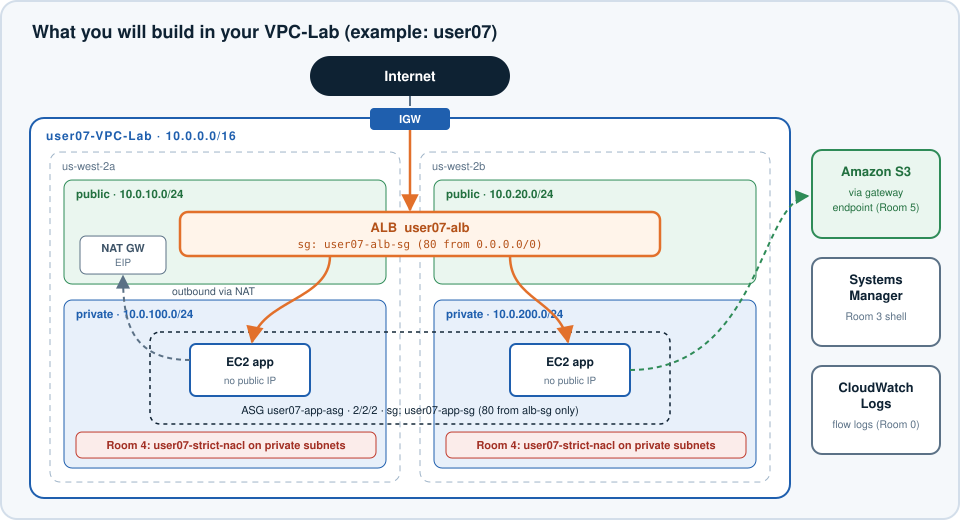
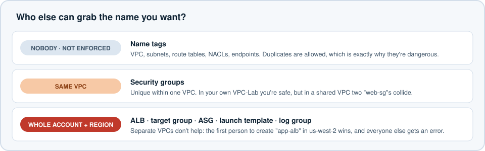
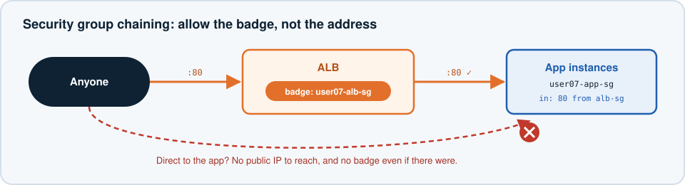
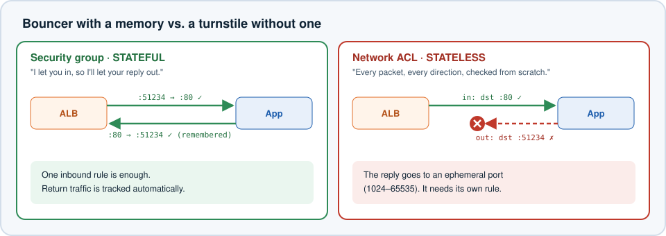
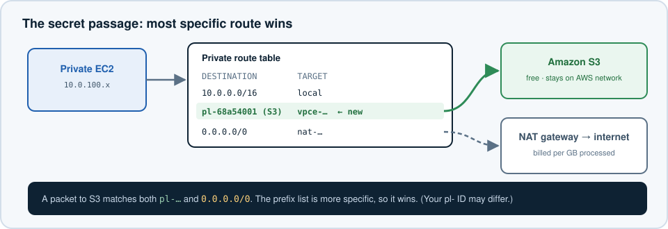

# VPC Lab 2 — The VPC Escape Room


## The Setup

In the VPC lab you built `VPC-Lab`: two public subnets, two private subnets, an internet gateway, and a NAT gateway. It's a well-built building with nobody inside.

In the next ~55 minutes you'll move an app into that building, put a guarded front door on it, and get into the private rooms without SSH keys. Then someone locks a door behind you, and you'll use the clues to get out.

Each room has **objectives**, an **escape check**, and **hints** you can expand. Hints get more specific as you go, so open them one at a time.



**You already know** EC2, launch templates, Auto Scaling groups, and security groups. **You'll learn:** security-group chaining, Session Manager, VPC Flow Logs, Logs Insights, network ACLs (and why "stateless" matters), and gateway endpoints.

---

## House Rules for a Shared Account

Everyone in the class is building in the **same AWS account and Region (us-west-2)**. Prefix every name with your ID (`user07` in the examples below).



| You create | Name it | Why the prefix matters |
|---|---|---|
| Your VPC (rename it) | `user07-VPC-Lab` | Five people's `VPC-Lab` in one list is a recipe for editing the wrong one |
| Security groups | `user07-alb-sg`, `user07-app-sg` | Names must be unique within a VPC. Prefixing is good habit. |
| Launch template | `user07-app-lt` | **Must be unique in the Region** for the whole account |
| Auto Scaling group | `user07-app-asg` | **Must be unique in the Region** for the whole account |
| Load balancer | `user07-alb` | **Must be unique in the Region** for the whole account, max 32 characters |
| Target group | `user07-app-tg` | **Must be unique in the Region** for the whole account, max 32 characters |
| Network ACL | `user07-strict-nacl` | Name tag only, but you'll want to find it fast |
| Log group | `/escape-room/user07/flow-logs` | **Must be unique in the Region** for the whole account |
| VPC endpoint | `user07-s3-endpoint` | Name tag only |

> **Golden rule:** Before you click **Delete**, **Edit**, or **Associate**, read the name. If it doesn't start with your ID, back away.

---

## Room 0 — Claim Your Vault (3 min)

**Objectives**

1. Rename your VPC and its subnets, route tables, internet gateway, and NAT gateway so every `Name` starts with your ID (for example `user07-VPC-Lab-subnet-public1-us-west-2a`).
2. Fill in your floor plan. You'll need these IDs all lab:

   | Thing | ID / CIDR |
   |---|---|
   | VPC | `vpc-…` · `10.0.0.0/16` |
   | Public subnet A / B | `subnet-…` · `10.0.10.0/24` / `subnet-…` · `10.0.20.0/24` |
   | Private subnet A / B | `subnet-…` · `10.0.100.0/24` / `subnet-…` · `10.0.200.0/24` |
   | Private route table(s) | `rtb-…` |
   | NAT gateway public IP | `x.x.x.x` |

   > Your CIDRs are different? No problem. Use yours everywhere this lab says `10.0.x.x`.

3. **Start the security cameras now** so they have footage by Room 4. Create a **VPC flow log** on your VPC:
   - Filter: **All**
   - Maximum aggregation interval: **1 minute**
   - Destination: CloudWatch Logs, log group `/escape-room/<your-id>/flow-logs`
   - IAM role: the one your instructor provided (for example `escape-room-flowlogs-role`)

**Escape check:** your flow log shows **Active**. 🔑

<details>
<summary>Hint — where do I rename things fast?</summary>

In the VPC console, filter the left-hand lists by **VPC ID** (top of the page: "Filter by VPC"). Then each subnet, route table, and gateway shown is yours. Click the pencil icon in the **Name** column to rename it.
</details>

<details>
<summary>Hint — what is a flow log?</summary>

A flow log records metadata about every network connection hitting the network interfaces in your VPC: source, destination, port, protocol, bytes, and whether it was **ACCEPT**ed or **REJECT**ed. It doesn't record packet contents. Find it under **Your VPCs → select your VPC → Flow logs tab → Create flow log**.
</details>

---

## Room 1 — Move In the App (12 min)

Launch an app tier: **two instances in the private subnets**, managed by an Auto Scaling group. No public IPs, no SSH keys.

**Objectives**

1. A security group `<id>-app-sg` in your VPC. **Leave inbound rules empty for now.** You'll lock it to the load balancer in Room 2.
2. A launch template `<id>-app-lt`:
   - Amazon Linux 2023, `t3.micro`, **no key pair**
   - Security group: `<id>-app-sg`
   - IAM instance profile: the Session Manager profile your instructor provided (for example `escape-room-ssm-profile`)
   - User data: the script below
3. An Auto Scaling group `<id>-app-asg` using that template, in **both private subnets**, with desired/min/max = **2/2/2**.

```bash
#!/bin/bash
dnf install -y httpd
TOKEN=$(curl -s -X PUT "http://169.254.169.254/latest/api/token" -H "X-aws-ec2-metadata-token-ttl-seconds: 300")
ID=$(curl -s -H "X-aws-ec2-metadata-token: $TOKEN" http://169.254.169.254/latest/meta-data/instance-id)
AZ=$(curl -s -H "X-aws-ec2-metadata-token: $TOKEN" http://169.254.169.254/latest/meta-data/placement/availability-zone)
cat > /var/www/html/index.html <<EOF
<html><body style="font-family:sans-serif;background:#0b1a2a;color:#fff;text-align:center;padding-top:15vh">
<h1>&#128275; You found the vault</h1>
<p>Served by <b>$ID</b> in <b>$AZ</b></p>
<p>Refresh to see the load balancer switch rooms.</p>
</body></html>
EOF
systemctl enable --now httpd
```

**Escape check:** in EC2 → Instances, two instances named by your ASG are **Running** in two different private subnets, with **no public IPv4 address**. 🔑

<details>
<summary>Hint 1 — the instances won't have a Name</summary>

ASG instances launch without a `Name` tag unless you add one. In the ASG's **Tags** section, add `Name = <id>-app` and tick **Tag new instances**, so you can find yours in a crowded instance list.
</details>

<details>
<summary>Hint 2 — how will dnf install anything with no public IP?</summary>

It goes through your **NAT gateway**. Look at your private route table: `0.0.0.0/0 → nat-…`. The instance can start outbound connections, but nobody on the internet can start one to it. Keep this in mind for Room 5.
</details>

<details>
<summary>Hint 3 — "Session Manager profile"?</summary>

An **instance profile** wraps an IAM role so EC2 can use it. The provided one has the managed policy `AmazonSSMManagedInstanceCore`, which lets the SSM agent (pre-installed on Amazon Linux 2023) register the instance with Systems Manager. That's how you'll get a shell in Room 3 without SSH.
</details>

---

## Room 2 — Build the Front Door (10 min)

Your app is in a private room. Give the public a single, guarded way in: an **Application Load Balancer** in the public subnets.

The key idea is **security group chaining**. Instead of allowing traffic from an IP range, the app's security group allows traffic from **another security group**.



**Objectives**

1. Security group `<id>-alb-sg`: inbound **HTTP 80 from 0.0.0.0/0**.
2. Edit `<id>-app-sg`: inbound **HTTP 80 from source `<id>-alb-sg`** (choose the security group as the source, not a CIDR).
3. Target group `<id>-app-tg` (instances, HTTP 80, your VPC). Attach your ASG to it.
4. Internet-facing ALB `<id>-alb` in **both public subnets**, security group `<id>-alb-sg`, listener HTTP 80 → `<id>-app-tg`.

**Escape check**

1. Both targets in `<id>-app-tg` are **healthy**.
2. Opening `http://<your-alb-dns-name>` shows the vault page. Refresh a few times: the instance ID and AZ change. 🔑

<details>
<summary>Hint 1 — attaching the ASG to the target group</summary>

Open the ASG → **Integrations** tab → **Load balancing → Edit** → choose **Application, Network or Gateway Load Balancer target groups** → select `<id>-app-tg`. While you're there, turn on **Elastic Load Balancing health checks** so the ASG replaces instances the ALB thinks are sick.
</details>

<details>
<summary>Hint 2 — targets stuck at "unhealthy"</summary>

Health checks come **from the ALB's network interfaces**, which carry `<id>-alb-sg`. If `<id>-app-sg` doesn't allow port 80 from that security group, every health check is dropped. Also give user data ~2 minutes to finish installing `httpd`.
</details>

<details>
<summary>Hint 3 — why chain SGs instead of allowing 10.0.10.0/24?</summary>

The ALB scales by adding and replacing network interfaces, and their IPs change. A security-group source means "anything wearing this badge," no matter what IP it has. It's also tighter: other things in the public subnets (a NAT gateway, someone's test instance) don't wear the badge.
</details>

> **Think about it:** what would a curious person see if they found one of your instances' private IPs and tried to connect from the internet? (Two separate reasons it fails.)

---

## Room 3 — The Hidden Passage (5 min)

You need a shell on a private instance. It has no public IP, no key pair, and no SSH port open.

**Objectives**

1. Connect to one app instance using **Session Manager** (EC2 → select instance → **Connect** → **Session Manager** tab).
2. From inside, run:

   ```bash
   curl -s https://checkip.amazonaws.com
   ```

**Escape check:** the IP printed is your **NAT gateway's public IP** from Room 0. 🔑

<details>
<summary>Hint — the Connect button is greyed out</summary>

Session Manager needs three things:

1. The SSM agent running (it is, on Amazon Linux 2023).
2. The instance profile with `AmazonSSMManagedInstanceCore`.
3. Outbound HTTPS from the instance to the Systems Manager service, which here flows through your NAT gateway.

If you added the profile after launch, the agent can take a few minutes to register. Rebooting the instance speeds it up.
</details>

> **Why it matters:** Session Manager connections are **outbound** from the instance, so you never open an inbound port. Every session can be logged, and access is controlled with IAM instead of shared SSH keys. Every instance behind this NAT shows up on the internet as the same single IP.

**Keep this session open.** You'll use it in Rooms 4 and 5.

---

## Room 4 — Lockdown (12 min)

A security consultant just "hardened" your private subnets. Apply their change exactly as written:

> **Consultant's ticket:** Create network ACL `<id>-strict-nacl` in your VPC.
> - Inbound rule 100: **Allow TCP 80 from 10.0.0.0/16**
> - Outbound rule 100: **Allow TCP 80 to 10.0.0.0/16**
>
> Associate it with **both private subnets**. "Only web traffic, only inside the VPC. Locked down."

Now reload your ALB URL.



**Objectives**

1. Prove what's broken using the **flow logs** you started in Room 0. Do **not** just guess.
2. Fix the NACL by **adding** the fewest rules you can. Don't delete the consultant's rules or disassociate the NACL.
3. Your fix must restore all three:
   - The website through the ALB
   - Your Session Manager session (reconnect if it dropped)
   - `curl https://checkip.amazonaws.com` from the instance

**Escape check:** all three work with `<id>-strict-nacl` still associated. 🔑🔑 (double key: this room is the hard one)

<details>
<summary>Hint 1 — look at the footage</summary>

CloudWatch → **Logs Insights** → select `/escape-room/<id>/flow-logs` → run:

```sql
fields @timestamp, srcAddr, srcPort, dstAddr, dstPort, action
| filter action = "REJECT"
| sort @timestamp desc
| limit 50
```

Flow logs arrive within a few minutes. Look at the **ports**. Are the rejected packets going *to* port 80, or *from* port 80?
</details>

<details>
<summary>Hint 2 — what does "stateless" mean?</summary>

A **security group** is stateful: if a request was allowed in, the response is automatically allowed out.

A **network ACL** is stateless: it checks every packet, in each direction, on its own. A response from your web server goes **from port 80** back **to the ALB's random high port** (an *ephemeral port*, 1024–65535). The consultant's outbound rule only allows packets **to** port 80.
</details>

<details>
<summary>Hint 3 — the website fix</summary>

Add an **outbound** rule that allows TCP **1024–65535** to `10.0.0.0/16`. That covers responses to the ALB.
</details>

<details>
<summary>Hint 4 — Session Manager and checkip</summary>

These are connections your instance **starts**, going **out** on TCP 443 to the internet (via NAT). So you need:

- Outbound: TCP **443** to `0.0.0.0/0` (the request)
- Inbound: TCP **1024–65535** from `0.0.0.0/0` (the response coming back to the instance's ephemeral port)

Rule numbers are evaluated lowest first, and the first match wins. Leave gaps (110, 120, 130) so you can insert rules later.
</details>

> **Think about it:** after your fix, what does the NACL actually add on top of your security groups? When *is* a NACL the right tool? (Talk it over with a neighbour.)

---

## Room 5 — The Secret Passage (8 min)

Your private instances reach S3 through the NAT gateway. NAT gateways charge **per GB processed**, so a fleet pulling terabytes from S3 pays for every byte to cross the NAT. A **gateway endpoint** gives S3 traffic its own private passage that skips the NAT, and it's free.



**Objectives**

1. Create a **gateway** VPC endpoint for `com.amazonaws.us-west-2.s3` named `<id>-s3-endpoint`, attached to your **private** route table(s).
2. Look at the private route table. Find the new route.
3. **Prove the passage works without the NAT.** In your Session Manager session, start this recorder (it keeps running even if your session drops):

   ```bash
   nohup bash -c 'for i in $(seq 1 40); do
     s3=$(curl -m 3 -s -o /dev/null -w "%{http_code}" https://s3.us-west-2.amazonaws.com)
     web=$(curl -m 3 -s -o /dev/null -w "%{http_code}" https://checkip.amazonaws.com)
     echo "$(date +%T)  s3=$s3  internet=$web"; sleep 5; done' > /tmp/passage.log 2>&1 &
   ```

4. In the console, **delete the `0.0.0.0/0 → nat-…` route** from your private route table. Wait 60 seconds. **Add it back.**
5. Reconnect with Session Manager and read the recording: `cat /tmp/passage.log`

**Escape check:** during the outage, `s3=` still shows a 3-digit HTTP code while `internet=000`. 🔑

<details>
<summary>Hint 1 — why did my Session Manager session die?</summary>

Session Manager itself travels through the NAT. When you removed the NAT route, you cut your own connection. That's why the recorder uses `nohup`. In production you'd add **interface endpoints** for `ssm`, `ssmmessages`, and `ec2messages` so Session Manager doesn't need a NAT at all. (They cost money per hour, so we skip them here.)
</details>

<details>
<summary>Hint 2 — reading the log</summary>

`s3=403` or `s3=200` means S3 answered (we didn't send credentials, so a 403 is still a success here). `000` means nothing answered within 3 seconds. The route with destination `pl-…` (a **prefix list** of S3's IP ranges) points to `vpce-…`. Routes are matched by **longest prefix**, so S3's specific ranges beat `0.0.0.0/0`.
</details>

> **Double-check:** your private route table has `0.0.0.0/0 → nat-…` again before you move on.

---

## Bonus Rooms (if you escape early)

- **🧩 The impostor.** Launch a `t3.micro` in a **public** subnet with a public IP, and try `curl http://<app-instance-private-ip>` from it. It fails even though both are in the same VPC. Which room's lesson explains why? Fix it *without* opening the app SG to a CIDR. (Terminate it afterwards.)
- **🧩 Chaos monkey.** Terminate one of your app instances and keep refreshing the ALB URL. How long until the site is fully balanced again? Where in the ASG's **Activity** tab do you see the replacement?
- **🧩 Top talkers.** Write a Logs Insights query that shows the **top 5 destination ports** by bytes in your VPC. Anything surprising?

---

## Clean Up — Lights Out (5 min)

Delete in this order. Read every name before you click.

1. Auto Scaling group `<id>-app-asg` (this terminates the instances)
2. Load balancer `<id>-alb`, then target group `<id>-app-tg`
3. Launch template `<id>-app-lt`
4. Network ACL `<id>-strict-nacl`: first associate both private subnets back with your VPC's **default** NACL (a NACL can't be deleted while subnets use it), then delete it
5. VPC endpoint `<id>-s3-endpoint`
6. Flow log on your VPC, then log group `/escape-room/<id>/flow-logs`
7. Security groups `<id>-app-sg` and `<id>-alb-sg` (delete the app SG first: it references the ALB SG)
8. If your instructor says the VPC lab is finished: **NAT gateway** (it bills by the hour), then **release its Elastic IP**, then delete your VPC.

---

## What You Escaped With

| Concept | One-line takeaway |
|---|---|
| Private subnets + NAT | Instances can call out; nobody can call in |
| SG chaining | Allow "anything wearing this badge," not "anything from this IP range" |
| Session Manager | A shell with no inbound ports, no keys, and an audit trail |
| Flow logs + Logs Insights | Network evidence instead of guessing |
| NACL vs SG | NACLs are stateless; every response needs its own rule |
| Ephemeral ports | Responses go back to a random high port (1024–65535) |
| Gateway endpoint | A free, private route to S3 that bypasses the NAT |
| Longest-prefix match | The most specific route wins |
